# Brain Signal Quest: Research & Change Plan

*Educational game design and UX review · November 2026 · version studied: branch `redesign-playhouse` (identical to `cloudflare-live`, PR [zahmed13-spec/brain-signal-quest#1](https://github.com/zahmed13-spec/brain-signal-quest/pull/1))*

---

## Executive summary (one page)

**Where Brain Signal Quest stands.** It is an accurate, private, accessible science *website* that contains a few game-like activities. It isn't yet a *game* kids come back to. Its strengths are real and rare in this category:
- The pathway science is accurate (optic chiasm crossing, the thalamus relay, smell bypassing the thalamus).
- Lighthouse Accessibility is 100 on every screen.
- It loads in under 0.3 s with no trackers.
- There's a genuine 3D "Brain Playhouse" that no kids' competitor I found offers.

**The main problem is that kids mostly *read*, and the doing comes second.** Every activity opens with a 39–47-word "mission" card. The text reads at a US grade 5.6–7.5 level (target audience: grades 3–7). Feedback is mostly text and colour. Most activities are one-shot: Neuron Relay is "complete" after a single ~10-second firing, and Memory Match always uses the same 6 pairs. Nothing brings a kid back tomorrow.

**What the best products do that we don't.** I played Duolingo, the PhET Neuron sim and LabXchange hands-on, and studied the rest from public pages and published design writing:

1. **Show → try → explain.** Duolingo's first exercise is a picture tap. PhET teaches the refractory period purely by greying out its "Stimulate Neuron" button.
2. **Instant, unmistakable feedback.** Duolingo uses a full-width green or pink sheet with the correct answer, a check or cross, and one big Continue.
3. **Retrieval that comes back.** Duolingo re-asked a word I'd missed within about 4 items, in a new format.
4. **Learner-paced segments with visible progress.** LabXchange shows a 6-section progress rail; Duolingo a top progress bar.
5. **A character who reacts in the moment,** not just on a header card.
6. **Mastery levels instead of one-time completion badges.**

**Top 10 changes** (the full list in §7 has 72 change IDs; some are cross-references to the same fix, leaving about 59 distinct changes):

| # | Change | ID | Impact | Effort |
|---|---|---|---|---|
| 1 | Fix 4 science-accuracy issues in Neuron Relay and the Playhouse (next neuron "fires" after one input, soma charge "drains" down the axon, no refractory period, a reversed pathway arrow) | EDU-01 | High | S |
| 2 | Bottom feedback sheet + spark burst + chime for every answer and check | FBK-01/02 | High | M |
| 3 | Cut on-screen reading: 1-sentence goal, hint on demand, text at grade ≤4.5 | ONB-02, EDU-02 | High | M |
| 4 | Optional read-aloud for all text (on-device speech, no network) | EDU-03 | High | M |
| 5 | Neuron Relay becomes 5 short levels (threshold, timing, two-input, inhibition, refractory) | CORE-01 | High | L |
| 6 | Quiz re-asks missed questions in-session, and a 3-question "Brain Warm-up" on return visits | CORE-06, PRG-04 | High | M |
| 7 | Playhouse "predict the next stop" taps, plus autoplay paced to reading speed (7 s → about 20 s per step) | CORE-07, BUG-09 | High | M |
| 8 | Mobile: first quest stop above the fold; Playhouse view before the scenario list | MOB-01/02 | High | M |
| 9 | 1–3 mastery stars per activity and a "Continue your quest" button | PRG-01/02 | High | M |
| 10 | Shared motion and sound tokens (durations, easing, a designed sound palette) | ANIM-01, AUD-01 | Med | S |

**Roadmap.** Phase A, about 2 weeks of quick wins, takes the game from "nice website" to "feels like a game." Phase B covers the core upgrades: levels, mastery and retrieval. Phase C holds the big bets: a story frame, a Brain Atlas sticker collection and a "Scientist mode."

**Must not change:** scientific accuracy and the citations, zero tracking and no accounts, full keyboard play, reduced-motion and no-flash safety, the 3D Playhouse with its 2D fallback, and editable `content.json` with Pages CMS.

---

## Table of contents

1. [Scope, method and assumptions](#1-scope-method-and-assumptions)
2. [Current state baseline (Phase 1)](#2-current-state-baseline-phase-1)
3. [Competitor notes (Phase 2)](#3-competitor-notes-phase-2)
4. [Design and learning-science research](#4-design-and-learning-science-research)
5. [What makes them work: 14 principles (Phase 3)](#5-what-makes-them-work-14-principles-phase-3)
6. [Side-by-side comparison (Phase 4)](#6-side-by-side-comparison-phase-4)
7. [The change list (Phase 5)](#7-the-change-list-phase-5)
8. [Priority roadmap](#8-priority-roadmap)
9. [Design system spec](#9-design-system-spec)
10. [Do NOT change](#10-do-not-change)
11. [Sources](#11-sources)

---

## 1. Scope, method and assumptions

| Item | Value (assumed or derived) |
|---|---|
| Location | Repo `zahmed13-spec/brain-signal-quest`, branch `redesign-playhouse` / `cloudflare-live` (the newest; the other branches `signal-station-redesign` and `brain-signal-quest-complete-polish` are earlier Nov 21 versions). Run locally with `python3 -m http.server 8000`. |
| Tech stack | Static HTML/CSS/vanilla ES modules, no build step; Three.js r170 (vendored, lazy-loaded) for the Playhouse; content in `content.json` edited through Pages CMS. |
| Audience | Ages 8–12 (US grades 3–7). Taken from the README; nothing in the code targets classrooms specifically, so I assumed **home and classroom, solo play**. |
| Learning goal | Brain regions and their jobs; how a neuron passes a signal (dendrites → threshold → action potential along myelin → synapse); sensory and motor pathways (vision, touch/reflex, hearing, motor, smell, learning/plasticity). |

**Method.**
- **Phase 1:** I read every source file and ran scripted first-time play-throughs in Chromium at 1280×800 and 390×844. Timings come from the Navigation Timing API, and reading levels are Flesch-Kincaid scores computed over every text field in `content.json`. There are 31 screenshots.
- **Phase 2:**
  - Each competitor was opened in Chromium and screenshotted.
  - Real CSS values (fonts, radii, shadows, transition curves, paragraph lengths) were extracted from the live DOM.
  - **Hands-on (guest play):** Duolingo (the full guest onboarding plus ~15 exercises, answering one wrong on purpose), the PhET Neuron sim, LabXchange's action-potential interactive, Code.org Hour of Code level 1, Crescent Loom (loader only).
  - **Public pages only:** Kahoot!, Gimkit, Blooket, Quizlet, Brilliant, Prodigy, DragonBox, ABCmouse, Khan Academy Kids, BrainPOP, Legends of Learning, Mosa Mack, iCivics, Scratch, Google Doodles, NASA Space Place, PBS KIDS. Game play behind these needs a host, an account or an app. **Blooket, Quizlet and neal.fun blocked automated browsers** (bot challenge, HTTP 403), so for those I used only published descriptions.
  - No accounts, personal data or purchases were used anywhere.
- **Honesty notes:**
  - Frame rates were measured on software WebGL (no GPU in the test container), so the 3D performance claims are provisional.
  - Competitor timings come from their CSS, not frame-by-frame capture.
  - I couldn't play Kahoot/Gimkit/Blooket live, so their notes describe published mechanics, labelled *[materials]*.

---

## 2. Current state baseline (Phase 1)

### 2.1 Inventory

| Type | What exists |
|---|---|
| **Screens** | Home/quest map (`#home`), Brain Explorer (`#brain`), Neuron Relay (`#neuron`), Reaction Lab (`#reaction`), Memory Match (`#memory`), Brain Playhouse (`#playhouse`), Quiz Boss (`#quiz`), Certificate (`#certificate`), Glossary & Sources (`#references`). Hash-routed in `game.js`. |
| **Levels** | None. Each activity is a single level. The Playhouse has 6 scenarios with 4–8 steps each (35 steps in total). |
| **Mechanics** | Click to reveal region facts (+ Peek-inside toggle). Click "send a message" until a threshold is passed (temporal summation with leak). Press when a lamp turns on (5 rounds, with presses under 100 ms rejected). Flip-card memory (6 fixed pairs). 3-choice quiz (4 random from 20). Step-through 3D pathway playback with play/pause/step/speed and orbit/zoom. End-of-scenario challenge ("pick" or "order"). |
| **Assets** | 30 inline SVG sprite icons; the SVG Sparky mascot; hand-drawn SVG brain (`js/brain.js`) and neuron (`js/neuron.js`); a procedural Three.js brain (`js/playhouse/scene3d.js`); 2 self-hosted fonts (Fredoka, Atkinson Hyperlegible). No raster art, audio files or video. |
| **Animations** | 6 `@keyframes` (`rise` screen entry .35 s, `hop` Sparky, `breathe` Sparky glow, `pop` badge, `fall` confetti, `flow` 2D pathway dashes). 10 distinct ad-hoc transition durations (.08 s–.6 s), all on the default `ease` curve. JS-driven: neuron message dots (650 ms), the action potential (1.9 s), neurotransmitters (1.1 s), the Playhouse camera (1.2 s ease-in-out cubic) and pulses. |
| **Sounds** | 6 synthesized WebAudio triangle-wave cues (`click`, `blip`, `good`, `oops`, `fire`, `win`), all **muted by default**. No music, narration or files. |
| **UI components** | Top bar with chips (Map, Glossary, Sound); quest tiles; a goal card ("Your mission" + hint); a play card; 3 "learn cards" (What just happened? / Brain in real life / Badge); region buttons; fact card; switch; stage list; round dots; flip cards; answer buttons; feedback box; scenario cards; step card; playback controls; speed slider; step dots; challenge box; toast; confetti layer; glossary tooltip; certificate. |

### 2.2 First 60 seconds (new player, desktop 1280×800)

| t | What the player sees or does |
|---|---|
| 0.1 s | The home screen is interactive (DOMContentLoaded 34 ms, 17 KB HTML, about 230 KB of resources in total including 80 KB `content.json`). 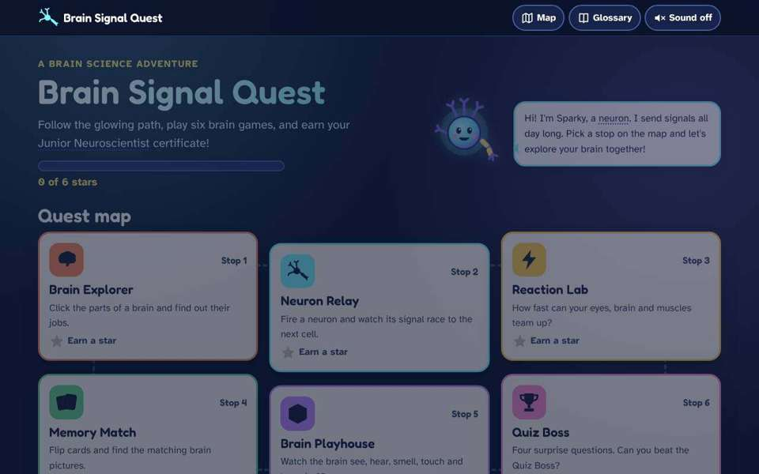 |
| 0–15 s | The kid reads the title, a 2-line intro, an empty star bar ("0 of 6 stars") and Sparky's 28-word speech bubble. **159 words** are on the home screen. Six equal tiles are shown and **all are unlocked with no recommended start**. The "map" is a 3×2 grid with a dashed rounded rectangle behind it, not a path. |
| ~15 s | The kid clicks "Brain Explorer". The page swaps (350 ms rise). A 39-word mission card plus a 25-word locked-cards area surround the diagram. 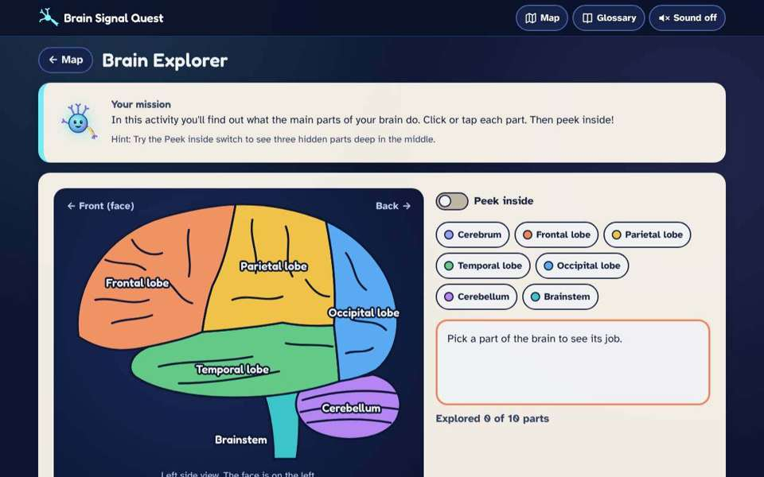 |
| ~17 s | **First real interaction** (a region click) happens about 0.5 s after the screen loads. *That's very fast, which is good.* The kid then reads a 28-word fact card per region. |
| 17–60 s | The kid clicks regions and reads cards. There is no challenge, no score and no wrong answer possible. The badge needs all 10 parts, including the 3 hidden behind "Peek inside" (the hint says so, but in small text). |

**Mobile (390×844):** only **one** quest tile is above the fold, and its top edge sits at 617 px. The home page is 1,814 px tall. 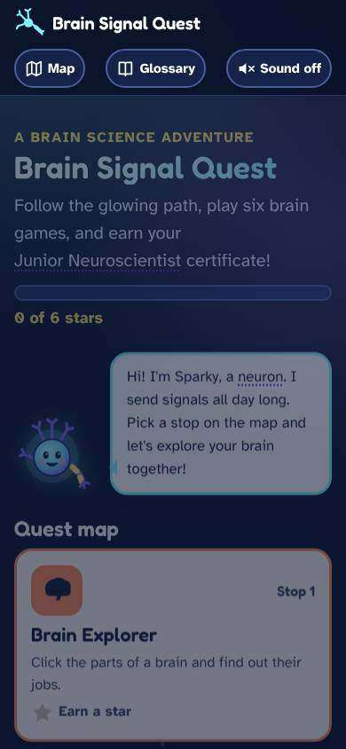

**Verdict:** time to first interaction is excellent (about 2 clicks). Time to first *challenge* is poor: the first thing that can be wrong arrives in Reaction Lab (stop 3) or at the end of a Playhouse scenario.

### 2.3 Core loop

There isn't one repeating loop. There are six separate one-shot loops:

- **Brain Explorer:** click → read → repeat ×10 → badge. No game.
- **Neuron Relay:** click ×3 → watch about 6 s of animation → badge. You can "Fire again", but it's identical. 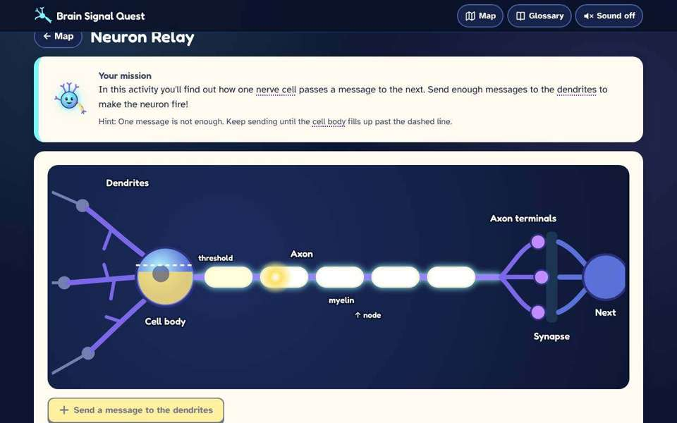
- **Reaction Lab:** 5 presses → static 6-box explanation. 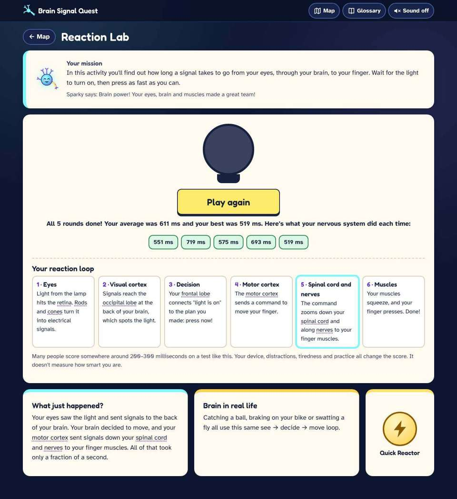
- **Memory:** 6 fixed pairs → done. **On a 1280×800 desktop, the 12-card board doesn't fit on screen**, so kids scroll mid-game. 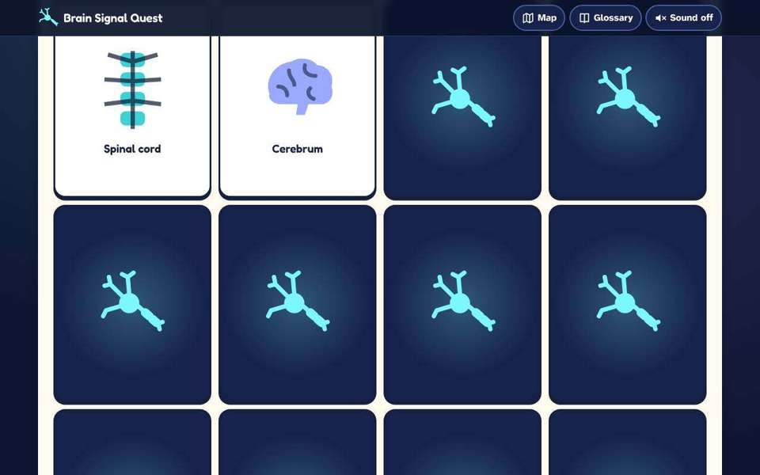
- **Quiz:** 4 questions → score → badge (awarded for finishing, not for passing).
- **Playhouse:** watch steps (autoplay advances every **7 s**, but steps average **38 words**; an 8-year-old reading at about 100–130 words per minute needs about 18–23 s) → 1 challenge → per-scenario badge. 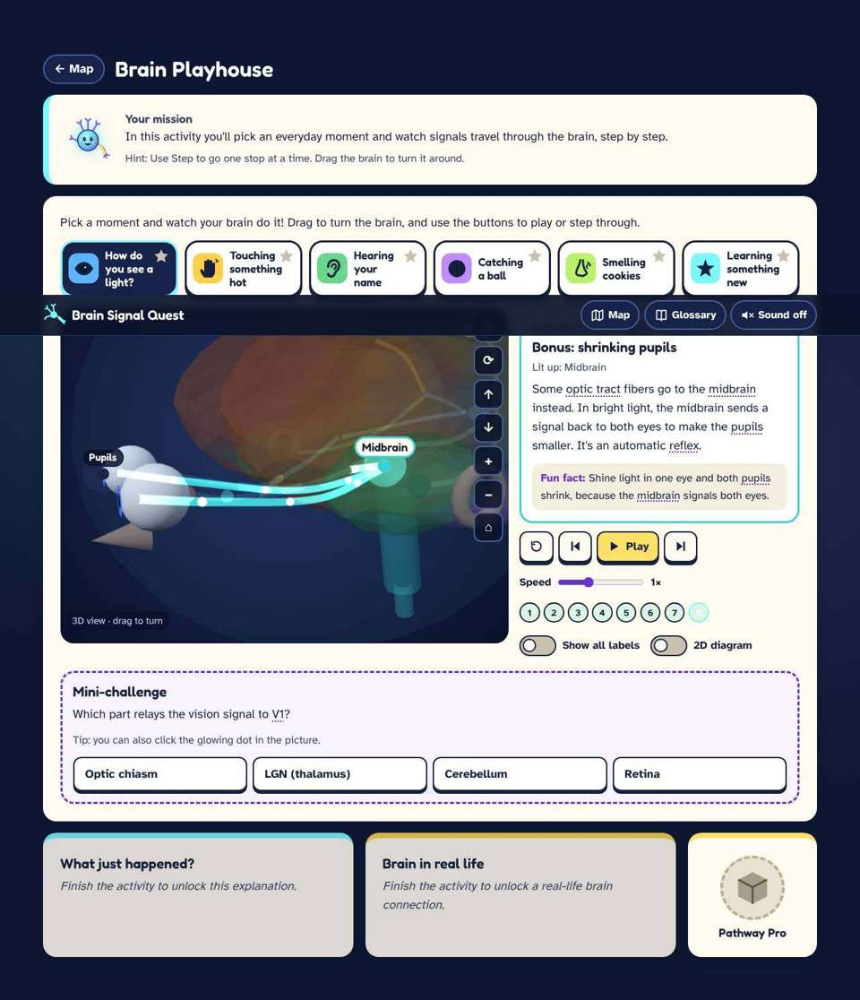

**Why would a kid keep playing?** To collect the 6 stars, once. After that nothing changes. There are no levels, no rising difficulty, no new content, and nothing that remembers what you got wrong.

### 2.4 Visual design

- **Palette:**
  - Navy chrome `#0d1733`, cream reading cards `#fffaf0`, ink `#17203d`, accents `#7cf7ff` and `#ffe066`.
  - One colour per region: frontal `#ff8a5b`, parietal `#ffcf4a`, temporal `#69d68c`, occipital `#5fb4ff`, cerebellum `#c08cff`, brainstem `#3fd0d4`, thalamus `#ff8fcf`, hippocampus `#b9f26a`, amygdala `#ff5c7a`.
  - This is consistent and distinctive. **Risk:** coral, pink and rose (frontal, thalamus, amygdala) sit close in hue and may be confusable for some colour-vision deficiencies. Labels mitigate this, but it hasn't been verified with a simulator.
- **Type:** Fredoka headings and Atkinson Hyperlegible body text at 18px. These are good choices. **Violations of the game's own 16 px minimum:** Playhouse labels (15.2 px and 13.6 px), the Playhouse mode chip (14.4 px), step-dot numbers (13.6 px), memory card labels at small widths (15.2 px) and neuron SVG labels (14–15 px).
- **Layout:** every activity stacks *mission card → play card → 3 learn cards*. On desktop the mission text runs the full card width, about 150 characters per line, roughly twice the readable maximum. Before completion, the learn cards are grey "Finish the activity to unlock" placeholders taking about 220 px of space.
- **Art style:** clean flat vector with soft shadows and pressable buttons. Consistent, but **sparse**: the tile icons are single glyphs, and only Sparky has personality. Competitors such as Khan Kids, Prodigy, DragonBox and PBS KIDS use full scene illustration for their "worlds".

### 2.5 Animation and motion

- **Present:**
  - Screen fade-up (350 ms, the same for every screen, with no sense of direction).
  - The neuron action potential as a glow blob hopping between myelin segments (saltatory).
  - Neurotransmitter dots.
  - Card flips (450 ms).
  - Badge pop (500 ms).
  - Confetti (1.4–2.3 s).
  - Sparky's breathing glow and hop.
  - Playhouse camera flights (1.2 s) and travelling pulses.
- **Missing:** no motion tokens (10 ad-hoc durations, default easing); no anticipation or overshoot on presses; no idle invitations (nothing pulses to say "tap me"); no screen transition that keeps the map → stop spatial relationship; no count-ups for numbers; Sparky has no expressions beyond hop and happy eyes.

### 2.6 Feedback

| Event | Current feedback |
|---|---|
| Correct quiz answer | The button turns green with "✓ Correct", plus a text box with a random cheer and an explanation. A sound plays if sound is on. No motion. 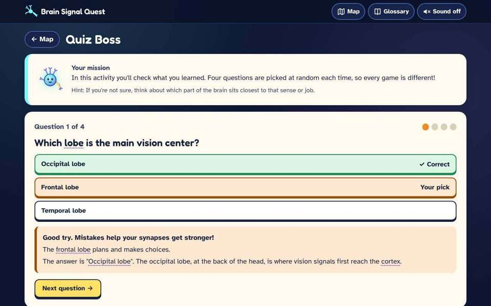 |
| Wrong quiz answer | An orange button marked "Your pick", the correct answer in green, and a box with "Good try…", why your pick is wrong and why the answer is right. **This is the strongest feedback in the game.** |
| Neuron fires | Text: "Threshold reached! The neuron fires!". The stage chips light in turn. There's no burst or flash at the moment of firing. |
| Activity complete | Confetti for about 2 s, a 3.2 s toast, Sparky's hop on the mission card (often scrolled off-screen) and the badge pop at the bottom of the page (often off-screen). **Bug:** the toast and confetti carry over to the next screen if the kid navigates quickly (seen as "Badge earned: Signal Sender!" on Reaction Lab). |
| Wrong action elsewhere | Reaction: "Too early!" in text only. Memory mismatch: text only, cards flip back after 1.6 s. |

### 2.7 Teaching

- **Mostly explain → do.** A text mission comes first, then interaction, then "What just happened?" text.
- **Neuron Relay is the only activity where the science *is* the mechanic** (summation to threshold, with leak). Brain Explorer is click-to-read exposition. Memory Match trains working memory with pictures but tests no neuroscience knowledge. The Quiz is retrieval practice, but isolated at the end and never spaced. The Playhouse is a strong *worked example* (watch the pathway step by step) with one check at the end.
- **Reading load** (Flesch-Kincaid grade, computed over `content.json`):

| Text group | FK grade | Words/sentence | Avg words per item |
|---|---|---|---|
| Activity goals | 4.8 | 12.2 | 24 |
| "What just happened?" | 6.3 | 13.0 | 30 |
| Region descriptions | 5.6 | 10.8 | 28 |
| **Neuron stage text** | **7.5** | 10.9 | 18 |
| **Quiz explanations** | **7.1** | 12.3 | 16 |
| Playhouse step text | 5.6 | 11.2 | 21 (38 including fun fact) |
| Playhouse fun facts | 6.0 | 14.0 | 17 |
| Glossary | 5.8 | 11.2 | 12 |

The neuron and quiz text is two or more grades above an 8-year-old. The 52-term inline glossary helps, but it adds a tap per word. **There's no audio support for weaker readers.**

### 2.8 Progression and motivation

- Six binary stars (done / not done), per-scenario Playhouse badges (6) and a printable certificate.
- There's no XP, levels, mastery, unlocks, streaks, story or avatar.
- Stars are given for *completion*, not *competence*: the Quiz badge is awarded at any score, including 0/4.
- All stops are unlocked, which supports autonomy but leaves "what should I do next?" unanswered.

### 2.9 Accessibility (measured)

- **Lighthouse Accessibility 100** on all 9 screens and Best Practices 100.
- Full keyboard play passes. A skip link, focus rings, live regions, text alternatives for every diagram and a reduced-motion mode exist. There's no flashing. Sound is off by default. Feedback never relies on colour alone.
- **Gaps:**
  - Reading level (§2.7).
  - No read-aloud.
  - The sub-16 px text listed in §2.4.
  - Step dots are 30 px targets (below the 44 px recommended for children's touch targets).
  - Line length on desktop.
  - No manual screen-reader pass has been done yet.

### 2.10 Mobile, performance, bugs and rough edges

- **Load:** home is ready in about 0.1–0.3 s locally. Lighthouse Performance is 97 on home and 46 on the Playhouse (software WebGL with a 4× CPU throttle). **53% of `content.json` (35 KB of 65 KB minified) is Playhouse data loaded on every visit.** Three.js is about 691 KB (171 KB gzipped), loaded only in the Playhouse; the view is ready about 0.77 s after opening.
- **3D frame rate:** 18–48 fps on *software* rendering. Not measured on a real GPU, Chromebook or tablet.
- **Mobile:**
  - One tile above the fold.
  - On the Playhouse, six stacked scenario cards push the 3D view below the fold ([screenshot](research/screenshots/bsq-30-mobile-playhouse.jpg)).
  - The neuron needs sideways swiping ([screenshot](research/screenshots/bsq-29-mobile-neuron.jpg)).
- **Bugs:**
  - The toast and confetti leak across screens.
  - The memory board overflows a 1280×800 viewport.
  - The Playhouse autoplay is too fast for reading.
  - "What just happened?" repeats the Reaction loop boxes.
  - The science issues below.

### 2.11 Science-accuracy flags (current build)

| # | Where | Issue | Severity |
|---|---|---|---|
| S1 | `js/neuron.js`, next-neuron step | After **one** action potential the next neuron's cell body turns **fully yellow (fired)**. That contradicts the game's own text ("If it gets enough nudges, it fires too") and the core threshold idea. | **High** (teaches the opposite of the lesson) |
| S2 | `js/neuron.js` `travelAP()` | The cell-body charge bar **drains in step with the travelling signal** (`charge = 1 − k·1.2`). This implies charge flows out of the soma down the axon like water in a pipe. In reality the action potential is *regenerated* at each node. | Medium (a known misconception) |
| S3 | Neuron Relay | **No refractory period.** "Fire again" works instantly, and nothing shows why signals travel one way or that firing is all-or-none (every spike is the same size). PhET teaches this by disabling its stimulate button. | Medium (an omission rather than an error) |
| S4 | `content.json` pathway `practicePath` (Learning scenario) | The last segment runs **motor cortex → frontal lobe**. Planning flows frontal → motor, so the arrow direction is backwards. | Low |
| S5 | Neuron SVG | The synapse is drawn as a solid teal bar, which reads as a wall or object in the gap. It should look like empty space between two membranes. | Low |
| S6 | Stage 2 text ("The cell body adds up… the neuron fires") | Acceptable for the age group. Optional precision: the spike starts where the axon begins (the axon hillock). | Info |

Everything else checked out against OpenStax A&P 2e §12.4, §12.5, §14.1 and §14.2, BrainFacts, NINDS and Chudler (the earlier redesign's science pass fixed the lens/cornea error).

---

## 3. Competitor notes (Phase 2)

Legend: **[hands-on]** played as a guest · **[page]** public pages studied live · **[materials]** published descriptions only (sign-in, host or bot-block).

### 3.1 Duolingo [hands-on]: the benchmark for feedback and onboarding

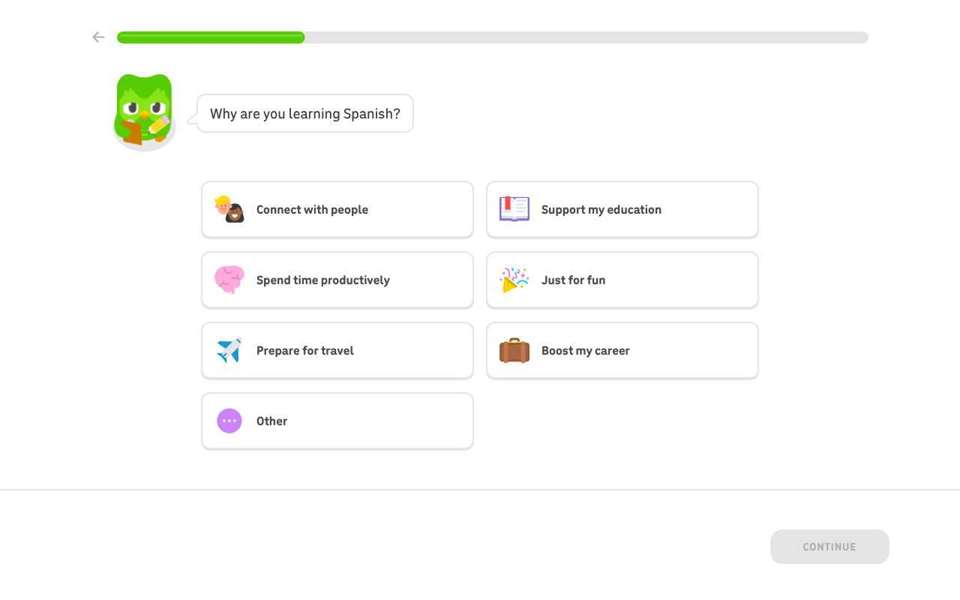 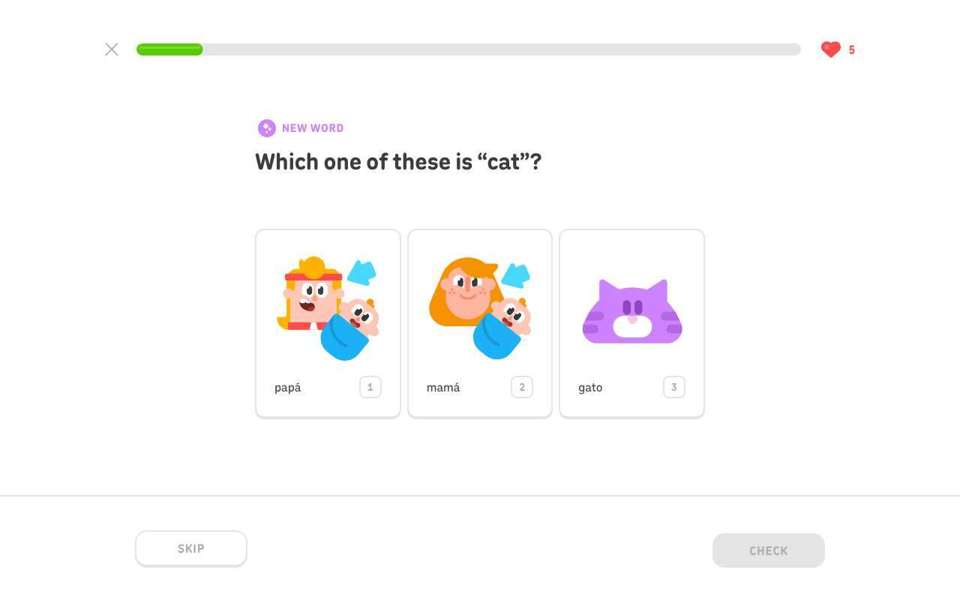

- **Onboarding:**
  - **9 single-tap screens** (goal, level, minutes per day…) before exercise 1, each one a mascot speech bubble plus big icon tiles.
  - A progress bar sits at the top the whole time. The Continue button stays greyed out until you choose an answer.
  - Long, but zero reading effort per screen. The **first exercise is recognition with pictures** ("Which one of these is 'cat'?"), so there's nothing to type or recall.
- **Core loop and session:**
  - Lessons of about 15 exercises, a few minutes each.
  - The words introduced (cat, dog, water, milk) **recycled immediately**: in a match-pairs exercise, and again as "Select the correct meaning".
  - **The word I deliberately missed ("dog") came back within about 4 exercises** in a new format.
- **Animation:**
  - Live CSS shows transitions of `transform .3–.4s cubic-bezier(.22,1,.36,1)` (a strong ease-out) and `filter .2s`.
  - Buttons are 50 px tall with a 12 px radius. Choice tiles have a 2 px bottom border that gives a "pressable" look.
- **Feedback:**
  - Correct: a full-width bottom sheet in light green (`#d7ffb8` measured), a check badge, "Nice job!"/"Great!" and a green CONTINUE.
  - Wrong: a pink sheet (`#ffe2e0`), a red ✕ and "**Correct solution: perro**".
  - A heart is lost (5 → 4). "Too easy / too difficult" self-report is always available.
  - Number keys 1–3 select choices.
  - 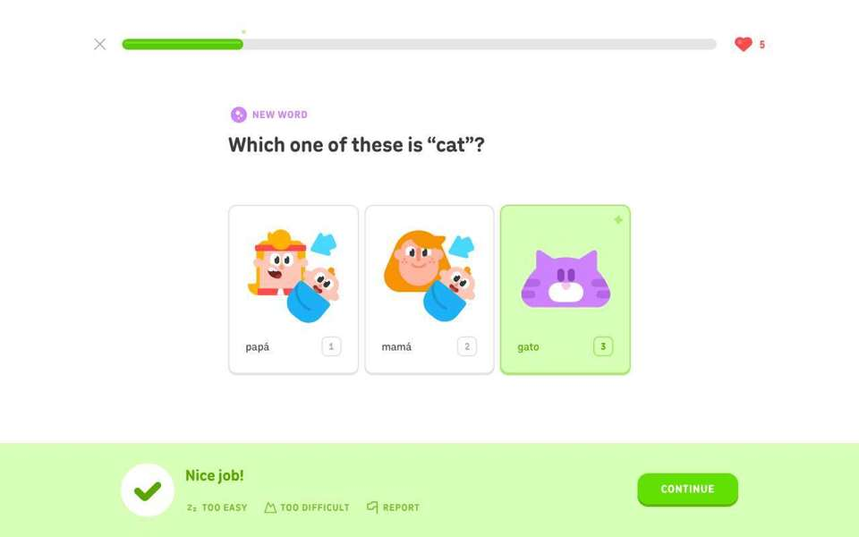 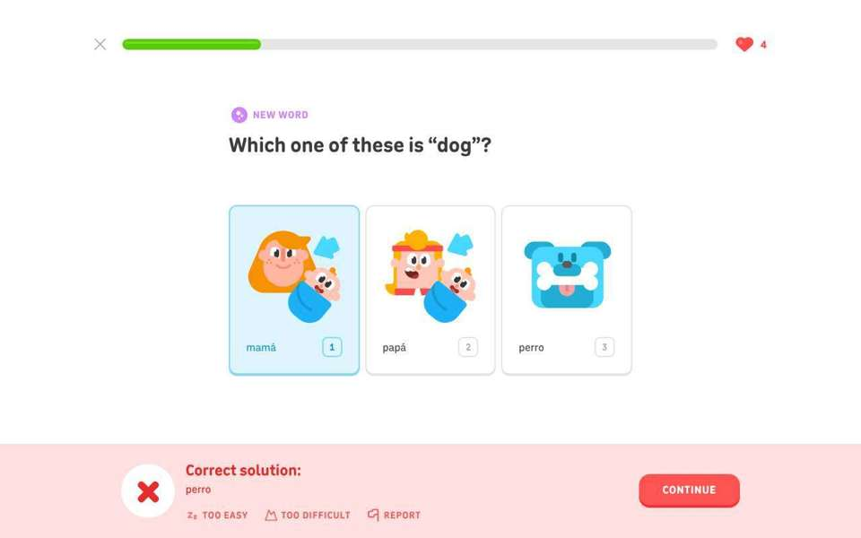
- **Visual system:** white background, one green brand colour, rounded Feather/DIN Rounded type; secondary blue Macaw `#1CB0F6` (official colour page).
- **Content formatting:** one prompt (5–8 words) per screen, pictures as the main information carrier, never more than one sentence of instruction.
- **Motivation:** XP, streaks, hearts, leagues and the Duo mascot. The design blog says motion is rough-animated in several passes to tune "rhythm and energy".
- **Mistakes:** framed as "Correct solution" with no scolding. Missed items are re-queued.
- **Accessibility and mobile:** large targets, keyboard shortcuts, mobile-first layout.
- **Steal this:** the **feedback sheet + re-queue missed items** pattern.

### 3.2 PhET "Neuron" (CU Boulder) [hands-on]: the benchmark for teaching through the mechanic

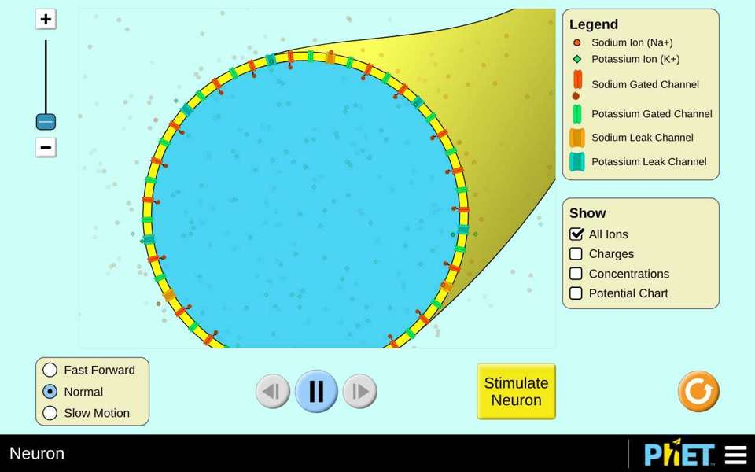 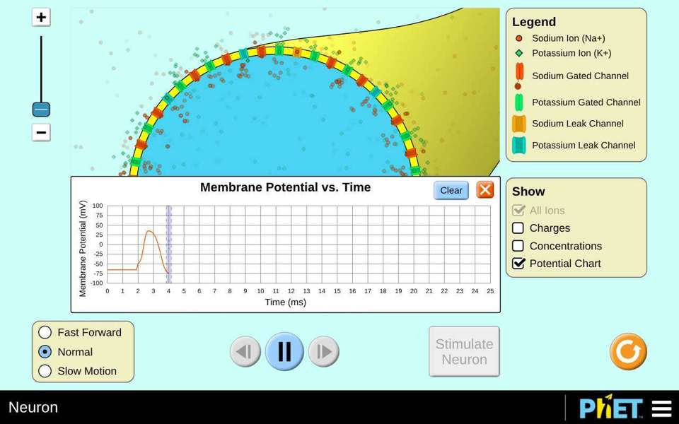

- **Onboarding:** none. There is no text instruction at all. One big yellow **"Stimulate Neuron"** button, a legend and "Show" checkboxes.
- **Core loop:** stimulate → watch ions move through channels → optional "Potential Chart" plots the spike (resting about −65 mV, peak about +30 mV, undershoot) in real time. Speed is Normal, Slow Motion or Fast Forward, with step and pause controls.
- **Implicit scaffolding:** after one click the button **greys out until the neuron can fire again**, which teaches the refractory period with zero words. This is exactly PhET's published "implicit scaffolding" design strategy (Podolefsky, Moore & Perkins).
- **Visual:** pale aqua background `#cdfef8`, high-contrast saturated controls, a canvas-rendered scene, legend panels.
- **Motivation:** none beyond curiosity. It's built for teacher-led inquiry.
- **Accessibility:** keyboard and description support exist in many PhET sims. This one exposed no accessible DOM controls to my probe.
- **Steal this:** **let the controls themselves teach rules** (a disabled stimulate button = refractory period) and offer an optional "Scientist mode" voltage trace for older kids.

### 3.3 LabXchange "Action Potentials: A Visual Introduction" [hands-on]

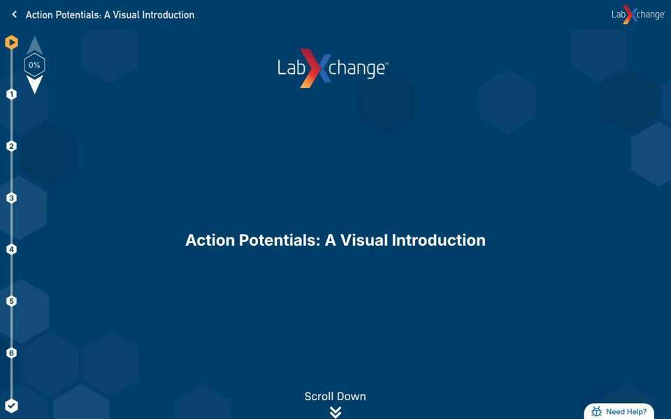

- **Format:** scroll-driven "scrollytelling" animation. A left rail shows **6 numbered sections and a % progress meter**. The first-screen instruction is a single sentence ("Scroll down… or use the navigational buttons").
- **Strength:** learner-paced segmenting (Mayer's segmenting principle) with an always-visible "where am I".
- **Weakness for our audience:** passive, written for high school and up.
- **Steal this:** a **numbered progress rail with a %** for multi-step explanations (Playhouse steps, Neuron levels).

### 3.4 Code.org Hour of Code [hands-on, level 1]

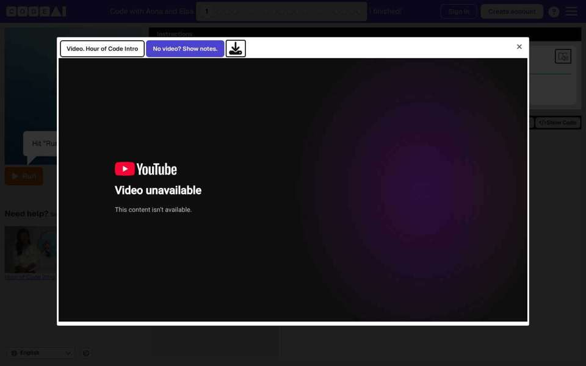

- **Onboarding:** an intro video modal (it didn't load in the test environment), then the character speaks a **one-sentence goal** in a bubble ("Hi! I'm Elsa… Help me create a single line.") next to the workspace.
- **Loop:** drag blocks → Run → see the result immediately → next level. Levels are tiny and numbered across the top.
- **Steal this:** the **one-sentence character goal** and **numbered micro-levels** with instant "Run" feedback.

### 3.5 Khan Academy Kids [page + materials]

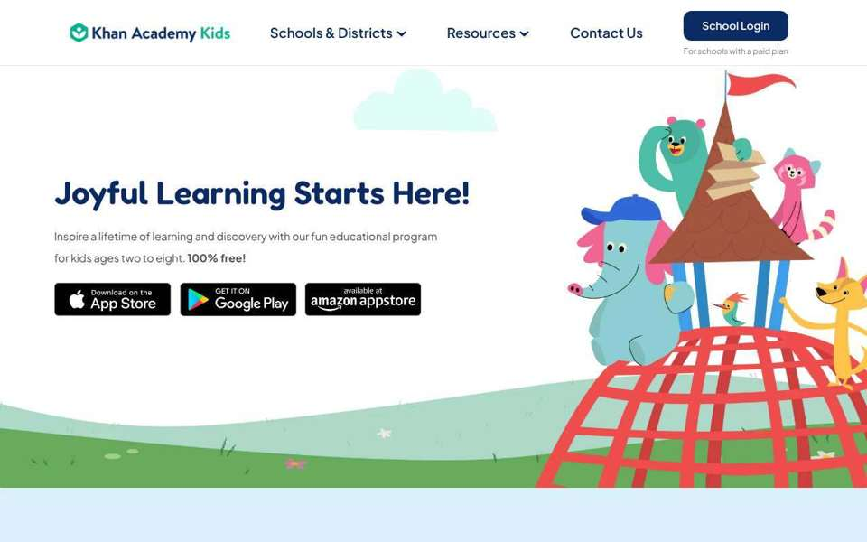

- A whimsical, bold-colour world with animal guides. Everything is **narrated aloud** for pre- and early readers. There's a personalized **Learning Path**, built with Stanford GSE input.
- A peer-reviewed study found pre-literacy gains over 10 weeks (Khan blog summary).
- Brand page: light pastel backgrounds (`#f4fafc`, `#fff9d7`), a 12 px button radius, **Plus Jakarta Sans**.
- **Steal this:** **read-aloud by default for young readers** and a single "what's next" path.

### 3.6 Kahoot! [page + materials]

- Join with a PIN only (verified at kahoot.it). Live, host-led, timed multiple choice.
- Answer tiles are coded by **both shape and colour** (triangle, diamond, circle, square), which is colour-blind safe. There's music, a countdown, a leaderboard and a podium finale.
- Brand CSS: Montserrat 800 headings, transitions of 0.2 s.
- **Steal this:** **shape + colour coding** on answers, and a *short* celebratory finale. Skip the speed pressure and public leaderboard for this age group (see §5 P13).

### 3.7 Gimkit [page + materials]

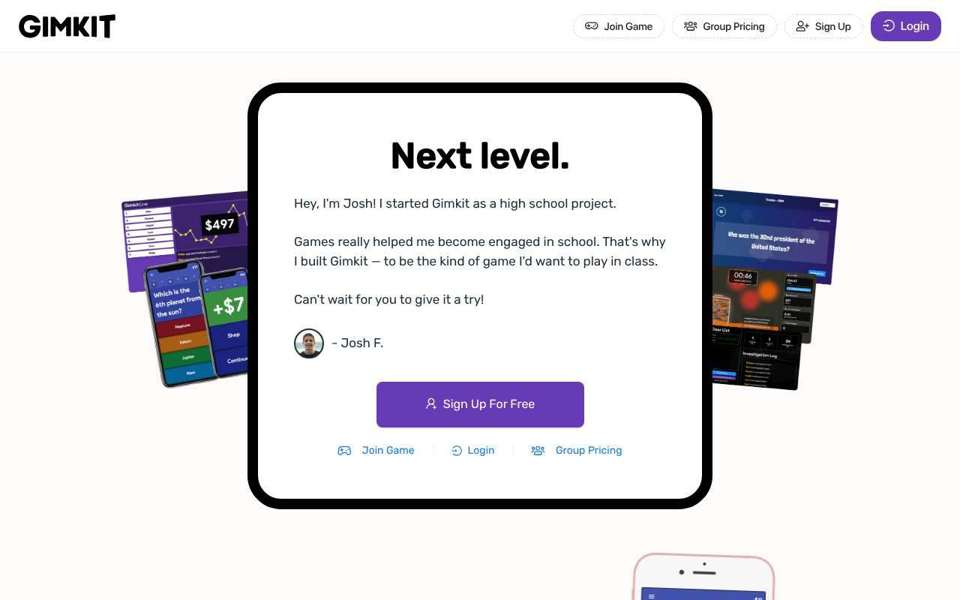

- Live classroom game where correct answers earn in-game cash that buys **power-ups and upgrades**: an economy loop that rewards repeated retrieval. The landing page is founder-voiced ("I started Gimkit as a high school project").
- CSS: pill buttons (`50px` radius), `0.2s cubic-bezier(.645,.045,.355,1)`.
- **Steal this:** *earned upgrades* that change how you play (for example, a stronger "myelin boost" after mastery), not just cosmetic badges.

### 3.8 Blooket [materials; site blocked automated browser]

- Question sets played inside varied **game modes** (tower defense, café, classic) with collectible "Blook" characters and random events. Used mostly for review and formative assessment.
- **Steal this:** **the same question bank reused in different mini-game wrappers.**

### 3.9 Quizlet [materials; site blocked automated browser]

- Flashcards plus an adaptive "Learn" mode that mixes recognition and written recall and repeats missed terms.
- **Steal this:** move from **recognition → recall** as mastery grows (glossary practice).

### 3.10 Brilliant [page + design write-ups]

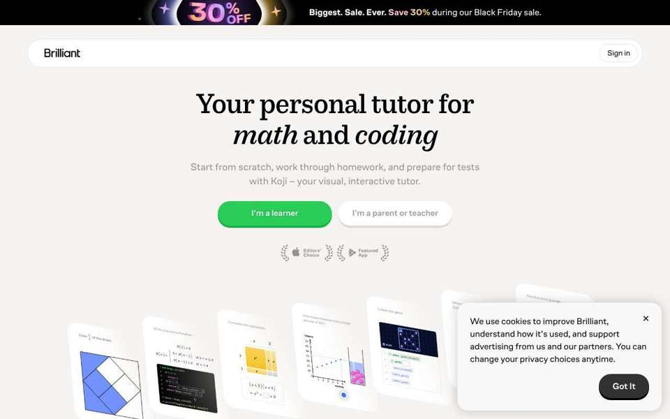

- Lessons are interactive problems first, with explanation after you try. The site describes responding "while reasoning is still fresh" so learners can revise.
- ustwo's redesign added game-like **lesson tiles, progress trackers, in-lesson celebrations and encouragement when learners struggle**.
- CSS: custom CoFo fonts; 54–56 px pill radius; `cubic-bezier(.22,1,.36,1)` entrance animations of 0.7–1 s.
- **Steal this:** **try-before-explain cards** with encouragement on struggle.

### 3.11 Prodigy Math [page + materials]

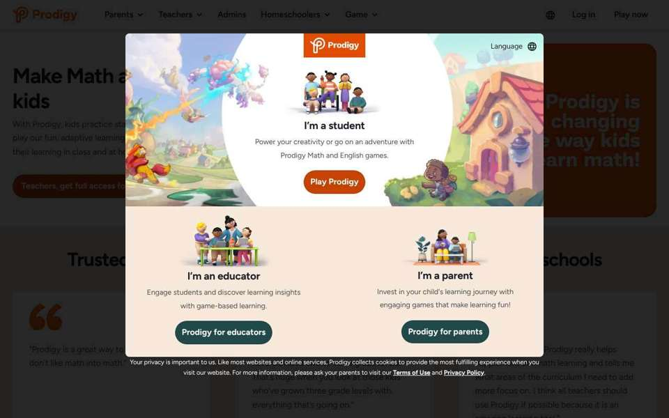

- A fantasy RPG where answering questions powers battle spells. There's an avatar, a world map and a story.
- Landing page: Figtree, a warm `#f7e9db` background, transitions of 0.2–0.35 s.
- Critics note that the learning is "extrinsic" to the battle mechanic.
- **Steal this:** a **world/story frame** for the quest map, *but* keep the learning inside the mechanic (see DragonBox).

### 3.12 DragonBox [page + research]

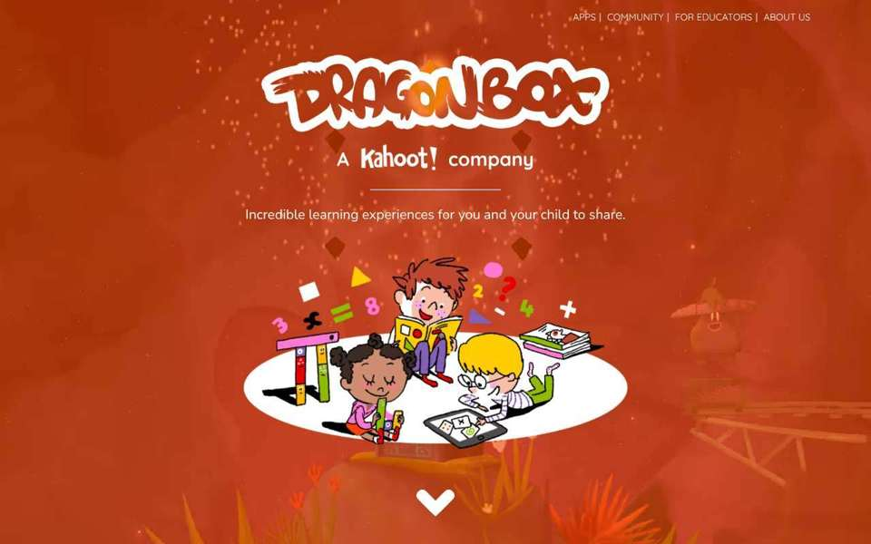

- Algebra is taught as cancelling and balancing cards on two sides of a box. Symbols gradually turn into real algebraic notation.
- It's the canonical example of **intrinsic integration** (Habgood), where the game mechanic *is* the maths.
- Brand: saturated orange and green (`#ff5b26`, `#8db302`), Nunito Sans.
- **Steal this:** **fade from playful representation to real science notation**. For example, the neuron "charge meter" gains real mV labels in later levels.

### 3.13 ABCmouse [page]

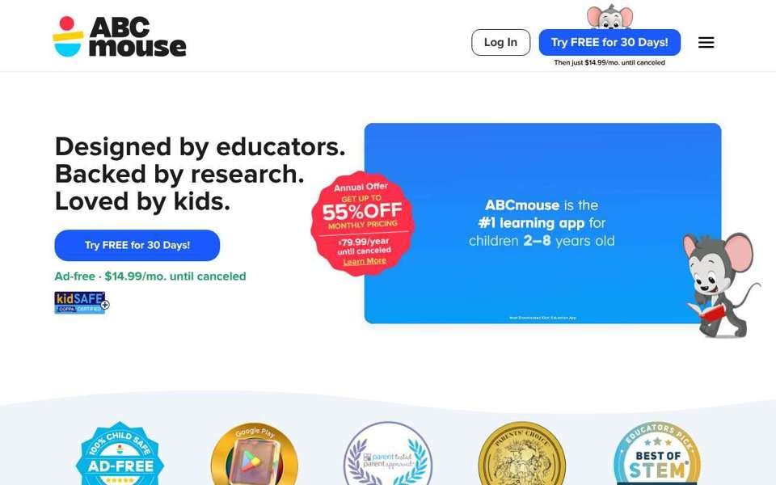

- The mascot enters with `hero-mascot-in .65s cubic-bezier(.2,.9,.3,1.1)` (overshoot) and then **idles with a 2.4 s ease-in-out bob**.
- A ticket-reward learning path.
- **Steal this:** **mascot idle bob and entrance overshoot**, which shows the character is "alive" at very low cost.

### 3.14 BrainPOP [page]

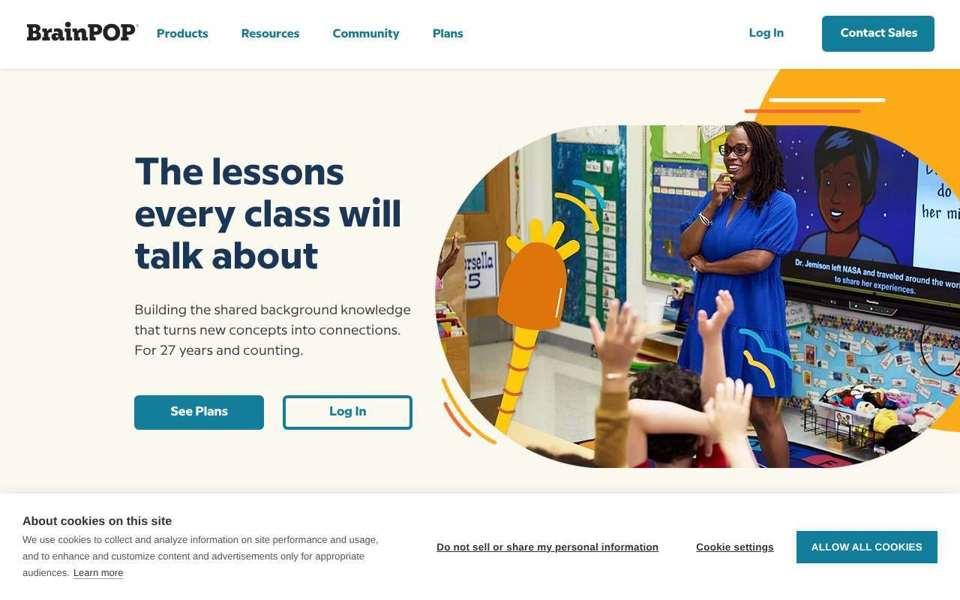

- Character-led animated explainer videos (a kid and a robot) followed by quizzes and activities. Elements appear on scroll with fade, grow and slow pulse (`.4–1.2s cubic-bezier(.645,.045,.355,1)`).
- **Steal this:** **character dialogue as the explanation format** ("What just happened?" told by Sparky, not as a text card).

### 3.15 Legends of Learning [page]

- More than 2,000 short, standards-aligned mini-games for teachers. The page has long marketing paragraphs (up to 139 words).
- **Steal this:** **short 5–10-minute playable units** tagged to a learning objective.

### 3.16 Mosa Mack Science [page]

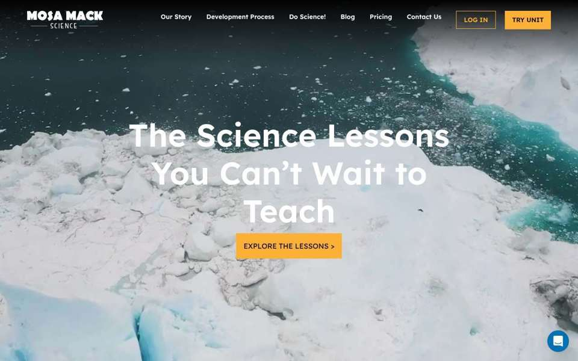

- Science taught through **mystery stories** with a detective character, then labs. Body font Lexend.
- **Steal this:** **a mystery hook** per Playhouse scenario ("Why did Maya pull her hand back before she said ouch?").

### 3.17 iCivics [page]

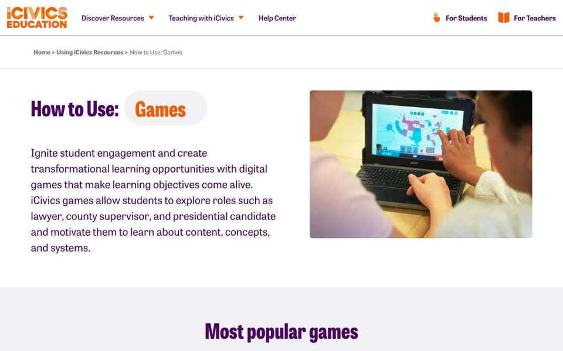

- Role-play civics games. Buttons are big pills (44 px radius, 67 px tall, 20 px bold) with a **solid 5 px offset shadow** (`0 5px 0 #bc26be`), a chunky, kid-friendly "pressable" style much like ours.
- **Steal this:** confirms our pressable button direction. Go taller (≥56 px) on touch.

### 3.18 Scratch [page]

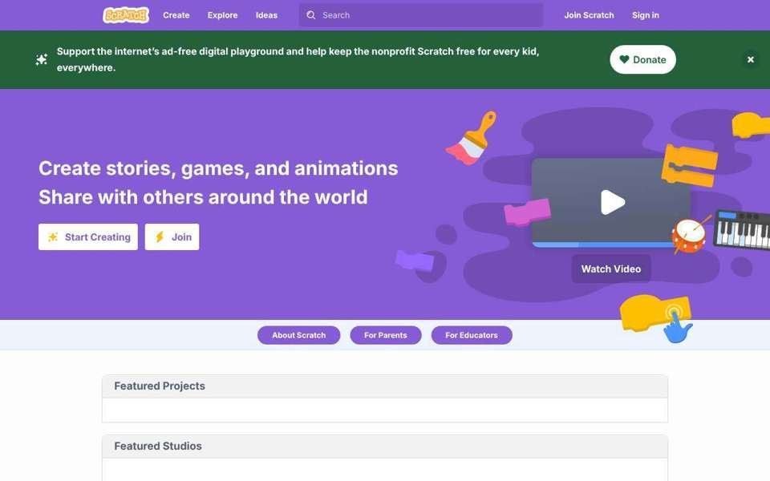

- Open-ended creation and remix; a purple brand (`#855cd6`), small 4 px radius.
- **Steal this (Phase C):** a **sandbox mode**. Let kids build their own pathway or neuron chain and share it via a URL (no accounts).

### 3.19 Google Doodles (Kids Coding) [page]

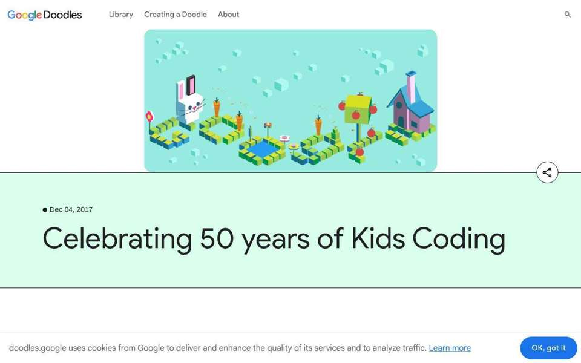

- A single-idea, under-2-minute playable doodle. The page uses outlined keywords as visual signals ("interactive", "coding"). Pill buttons with a 99 px radius.
- **Steal this:** **ultra-short single-mechanic games** as on-ramps (for example, a 60-second "Fire the neuron" warm-up).

### 3.20 PBS KIDS Games & NASA Space Place [page]

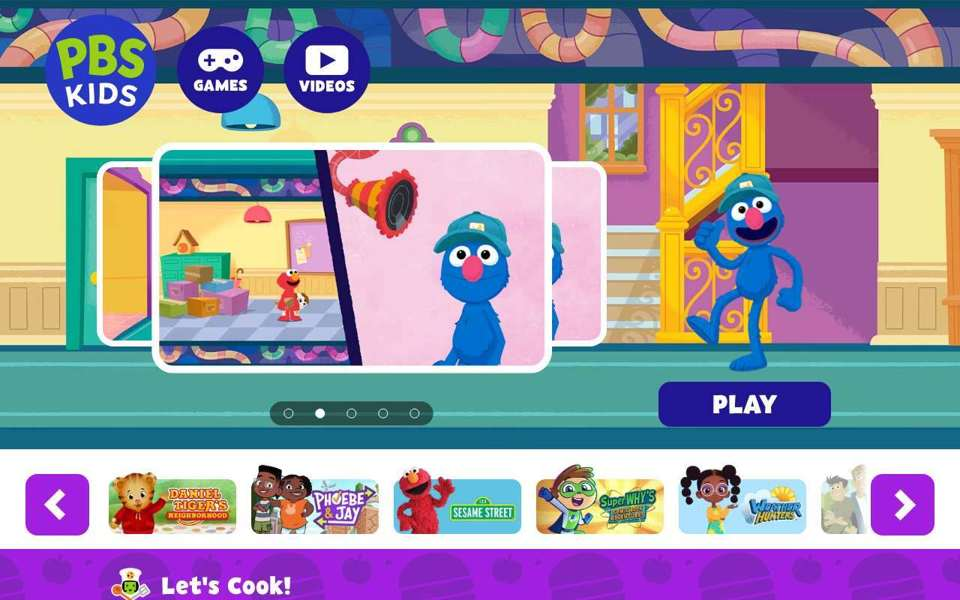 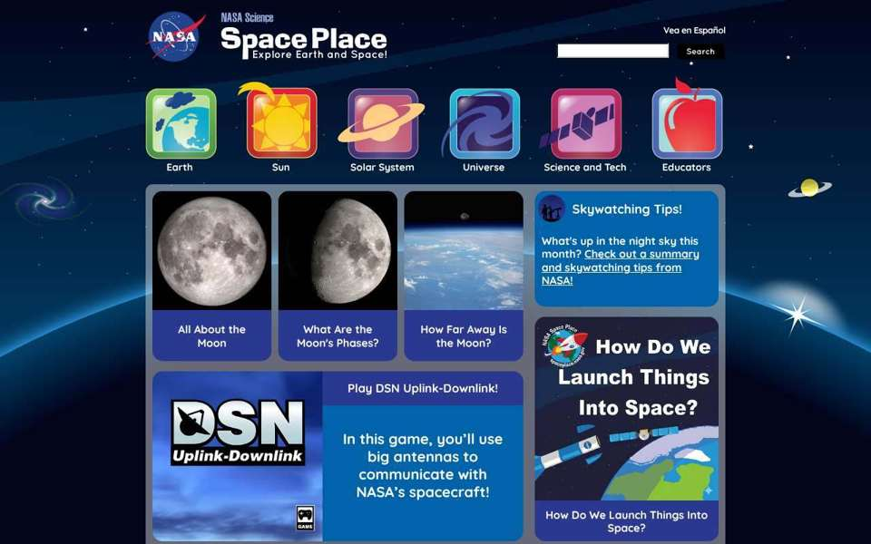

- **PBS KIDS:** one giant PLAY button per hero; carousel bounce and scale micro-animations (`.13–.2s`); characters everywhere.
- **NASA Space Place:** dark space background with large illustrated, colour-coded topic tiles.
- **Steal this:** **one dominant action per screen** (PBS) and **illustrated tiles on a dark world** (Space Place, which matches our night-brain palette).

### 3.21 Neuroscience-specific tools [page/materials]

- **Crescent Loom: Action Potential Explorer** (itch.io): a tinkerable electrophysiology explorable. It loaded, but marks itself work-in-progress. 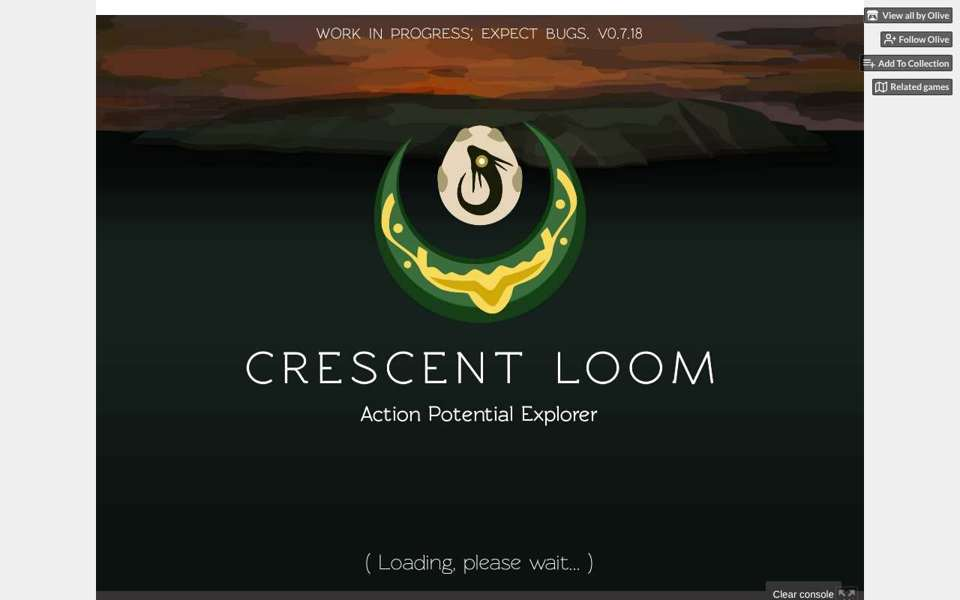
- **BrainFacts "Action Potential Interactive"** (educator page) points to CU Boulder's ion-channel simulation, which is text-heavy (paragraphs up to 114 words).
- **Neuroscience for Kids "Neuron Chain"** (Chudler) is a *physical* relay game in which kids are the action potential.
- **Gap in the market:** I found **no kid-first, game-like neuron or brain-pathway experience** that combines play, accurate pathways and progression. That's Brain Signal Quest's opportunity.

### 3.22 Extracted CSS facts (live DOM, Nov 2026)

| Product | Heading font | Button radius | Notable motion values |
|---|---|---|---|
| Duolingo | duolingo-sans 700 | 12 px | `transform .3–.4s cubic-bezier(.22,1,.36,1)` |
| Brilliant | CoFo Robert 500 | 54–56 px | `.7–1s cubic-bezier(.22,1,.36,1)`; press `transform .1s ease-out` |
| ABCmouse | AofL Sans 700 | 14–22 px | mascot-in `.65s cubic-bezier(.2,.9,.3,1.1)`; idle bob `2.4s ease-in-out` |
| Kahoot | Montserrat 800 | 4 px | `.2s ease` |
| Gimkit | Rubik 700 | 50 px | `.2s cubic-bezier(.645,.045,.355,1)` |
| iCivics | Tablet Gothic 600 | 44 px + `0 5px 0` shadow | `.15–.3s cubic-bezier(.4,0,.2,1)` |
| BrainPOP | custom | 6 px | fade, grow `.4–1.2s cubic-bezier(.645,.045,.355,1)` |
| PBS KIDS | PBS Kids Headline | — | bounce/scale `.13–.2s ease` |
| **Brain Signal Quest** | Fredoka 600 | 12 px + `0 .3rem 0` shadow | `.08–.6s`, all default `ease` |

---

## 4. Design and learning-science research

| Finding | Evidence | Implication for BSQ |
|---|---|---|
| **Retrieval practice** beats re-reading; **spacing** beats massing. Successive relearning combines both. | Dunlosky et al. 2013; Dunlosky et al. tutorial review (*Cognitive Research*, 2018); PMC review of practice testing; Dunlosky, Rawson et al. on successive relearning | Quiz items should resurface across activities and visits. Missed items re-queue. |
| **Feedback** effects depend heavily on type: task- and process-level feedback ("why") helps most; praise of the self helps least. | Hattie & Timperley 2007 | Keep our "why your pick is wrong" feedback (rare and good). Make cheers specific, not generic ("Brain power!"). |
| **Coherence, signaling and segmenting:** cut extraneous material, highlight essentials and let learners pace segments. | Mayer (Cambridge Handbook; Mayer's summary: coherence 18/19 tests positive, signaling 26/28) | Cut the duplicate "What just happened?" text, highlight the active structure (already done well), make autoplay learner-paced. |
| **Worked examples** help novices, then fade (expertise reversal). | Sweller; Kalyuga 2007 | The Playhouse is a worked example. Add faded steps (kids predict the next stop) as they progress. |
| **Productive failure:** trying before instruction can deepen understanding. | Sinha & Kapur 2021 meta-analysis (53 studies) | "Predict, then reveal" in the Playhouse, and tinker-first Neuron levels. |
| **Intrinsic integration:** learning embedded in the core mechanic outperforms bolt-on quizzes (possibly through attention). | Habgood (Zombie Division); Cutting & Iacovides 2022; DragonBox | The neuron *mechanic* should carry the lesson (summation, inhibition, refractory). Avoid "answer to attack". |
| **Implicit scaffolding:** guide through the design of controls, not text. | Podolefsky, Moore & Perkins 2013 | Disable fire during the refractory period, give dendrites tap affordances, fewer instructions. |
| **Rewards can undermine intrinsic motivation** when they're expected and contingent on mere participation. Informational, competence-signalling feedback doesn't. | Deci, Koestner & Ryan 1999 (128 experiments) | Stars should reflect *mastery* (informational), not mere completion. Avoid streak guilt and loss-aversion mechanics for kids. |
| **Games satisfy autonomy, competence and relatedness.** | Ryan, Rigby & Przybylski 2006 | Keep free choice of stops (autonomy), add levels with clear growth (competence), and make Sparky a companion who reacts (relatedness). |
| **Juice:** excess, immediate audiovisual response to input improves game feel, in moderation. | Jonasson & Purho, "Juice it or lose it" (GDC Europe 2012); game-feel literature | Add particles, press feedback and sound to *learning-relevant* moments only. |
| **Spaced-repetition modelling** at scale (half-life regression) raised daily engagement 12% at Duolingo. | Settles & Meeder 2016; Duolingo blog | A lightweight local version (per-question "last missed" plus an interval) is feasible with localStorage and no accounts. |
| **Reading load** for grades 3–5: shorter sentences (under 12 words is "short"), common 1–3 syllable words. | Learning Commons sentence rubric; readability references | Target FK ≤ 4.5 for core text, sentences ≤ 12 words on average, and a glossary for unavoidable terms. |
| **Character and onboarding motion** is rough-animated for "rhythm and energy" and given a "beat". | Duolingo design blog (streak milestone animation) | Give every feedback moment a beat: anticipation → hit → settle. |

---

## 5. What makes them work: 14 principles (Phase 3)

**P1. Show → try → explain, not explain → try.**
- Examples: Duolingo's first exercise is a picture tap with no instructions. PhET has no instructions, only a Stimulate button. Brilliant gives an interactive problem before the explanation.
- Why: productive failure and prediction create the "need to know" that makes the explanation stick (Kapur), and reading first loads working memory before there's anything to anchor it to (Sweller).

**P2. One sentence of instruction, spoken by a character.**
- Examples: Code.org ("Help me create a single line."), Duolingo's owl bubbles, Khan Kids' narrated guides.
- Why: coherence (Mayer) and relatedness (SDT). A character turns instruction into conversation.

**P3. Instant, full-screen-obvious feedback with the correct answer.**
- Examples: Duolingo's green/pink sheet with "Correct solution", Kahoot's reveal screen, Brilliant's "while reasoning is fresh".
- Why: immediate task-level feedback is among the most powerful effects (Hattie & Timperley), and showing the correct answer prevents wrong answers from being encoded.

**P4. Mistakes are safe, and missed items come back.**
- Examples: Duolingo re-asked "dog" about 4 items later in a new format, Quizlet Learn repeats missed terms, Blooket reuses the same bank in new modes.
- Why: retrieval plus spacing (Dunlosky), and a low-stakes framing keeps the affective cost of errors low.

**P5. The mechanic is the lesson.**
- Examples: DragonBox (cancel cards = algebra), PhET (disabled button = refractory period), Code.org (run = execute).
- Why: intrinsic integration focuses attention on the target concept (Habgood; Cutting & Iacovides).

**P6. Controls teach rules (implicit scaffolding).**
- Examples: PhET's greyed button, Duolingo's disabled Continue until you choose, Code.org's limited block palette.
- Why: constraints communicate rules without text (Podolefsky et al.).

**P7. Tiny, numbered segments with a visible "where am I".**
- Examples: LabXchange's 6-section rail with %, Duolingo's top progress bar, Code.org's numbered level bubbles.
- Why: segmenting (Mayer) and goal-gradient motivation. Kids see the end.

**P8. A living companion who reacts in the moment.**
- Examples: ABCmouse's mascot entrance overshoot and 2.4 s idle bob, Duolingo's owl expressions, BrainPOP's character duo, PBS characters.
- Why: relatedness (SDT), and emotional signalling makes feedback salient without more text.

**P9. A world or path with one obvious next step.**
- Examples: PBS's one giant PLAY, Khan Kids' Learning Path, Prodigy's world map, NASA's illustrated tiles.
- Why: it reduces choice overload for young users while keeping optional autonomy.

**P10. Juice on the *learning* moments.**
- Examples: Duolingo's motion passes for "rhythm and energy", Kahoot's podium finale, PBS's bounce micro-animations (.13–.2 s).
- Why: game feel signals cause and effect. Juice applied to the concept (the spike, the synapse) also acts as signaling (Mayer).

**P11. Mastery over participation.**
- Examples: Duolingo's levels and crowns, Khan's mastery levels, Gimkit's upgrades bought with correct answers.
- Why: competence feedback is informational, so it doesn't undermine intrinsic motivation the way participation rewards can (Deci et al.).

**P12. Same content, many wrappers.**
- Examples: Blooket modes, Quizlet's flashcards → Learn → Test, Duolingo's exercise types.
- Why: variety supports spaced retrieval without boredom, and transfer improves with varied practice.

**P13. Calm motivation for kids (no shame mechanics).**
- Examples: Khan Kids (no streak pressure, ad-free), PBS. *Counter-example:* the streak and leaderboard pressure in adult and teen products.
- Why: for ages 8–12, loss-aversion streaks and public ranking risk anxiety. Autonomy-supportive design sustains motivation better (SDT).

**P14. Accessibility as a default, not a mode.**
- Examples: Kahoot's shape + colour answers, Duolingo's keyboard numbers, Khan Kids' narration, PhET's description work.
- Why: reaches early readers and disabled learners and reduces extraneous load for everyone.

---

## 6. Side-by-side comparison (Phase 4)

Confidence: **H** = hands-on, **M** = partial hands-on, **L** = public materials only. Scores are 1–10 for the target audience (ages 8–12), not general quality.

| Dimension | **BSQ** | Duolingo (H) | PhET Neuron (H) | Khan Academy Kids (L) | Code.org HoC (M) |
|---|---|---|---|---|---|
| First impression | **7** | 9 | 6 | 9 | 8 |
| Onboarding | **6** | 9 | 7 | 9 | 8 |
| Core loop fun | **4** | 9 | 6 | 8 | 8 |
| Visual polish | **7** | 10 | 6 | 9 | 7 |
| Animation quality | **5** | 10 | 6 | 9 | 7 |
| Feedback / juice | **4** | 10 | 5 | 9 | 7 |
| Teaching effectiveness | **6** | 8 | 8 | 8 | 8 |
| Content formatting | **5** | 9 | 7 | 9 | 7 |
| Motivation / progression | **4** | 10 | 2 | 8 | 7 |
| Replayability | **3** | 10 | 6 | 8 | 6 |
| Accessibility | **8** | 8 | 6 | 8 | 7 |
| Mobile experience | **5** | 10 | 6 | 9 | 6 |
| Performance | **7** | 8 | 7 | 7 | 6 |

**Why each BSQ score (from Phase 1 observations):**

- **First impression 7:** a cohesive night-brain look and a friendly Sparky (§2.4). But 159 words on the home screen, a grid that only *claims* to be a map, and no single "Play" action.
- **Onboarding 6:** first interaction is about 0.5 s after entering a stop, which is excellent. But every stop opens with a 39–47-word mission card, and there's no first-run path or recommended start.
- **Core loop fun 4:** six one-shot loops; Neuron Relay lasts about 10 s of input; Memory is always the same pairs; Brain Explorer has no challenge (§2.3).
- **Visual polish 7:** a consistent token system, region colours and good type. But sparse illustration, sub-16 px labels, about 150-character lines and grey placeholder cards (§2.4).
- **Animation 5:** the AP hop and camera flights are good. But there are no motion tokens, every curve is default `ease`, there are no idle invitations or count-ups, and screen transitions don't relate the map to the stop (§2.5).
- **Feedback/juice 4:** answer feedback is text and colour. The completion celebration often happens off-screen, and toasts leak across screens. Sound is off and minimal (§2.6).
- **Teaching 6:** accurate science, strong wrong-answer explanations and a worked-example Playhouse. But explain-first, reading grade 5.6–7.5, retrieval isolated at the end, and the S1–S3 neuron issues (§2.7, §2.11).
- **Content formatting 5:** 2–3-sentence chunks and inline glossary are good. But there are several text cards per screen, duplicate explanations, and 38 words per Playhouse step against a 7 s autoplay.
- **Motivation 4:** binary stars for completion (the Quiz badge is earned even at 0/4), no levels, story or "next" (§2.8).
- **Replayability 3:** only the Quiz randomizes, and nothing remembers mistakes or invites a return.
- **Accessibility 8:** Lighthouse 100, keyboard, reduced motion and no flashing. Docked for reading level, no read-aloud, sub-16 px text and 30 px targets.
- **Mobile 5:** no horizontal scroll and everything works. But one tile above the fold, the Playhouse view buried under six cards, and a swipe-to-see neuron.
- **Performance 7:** 0.1–0.3 s home, Lighthouse 97, lazy 3D. But 53% of the eagerly loaded JSON is Playhouse-only, and 3D is unverified on real low-end GPUs (18–48 fps in software).

---

## 7. The change list (Phase 5)

Format: **ID — Title** · *Impact / Effort* · then Problem, Inspiration, Proposed change, Why, Files and Acceptance criteria (AC).

### 7.1 Onboarding

**ONB-01 — First-run "Start your quest" path** · *High / M*
- **Problem:** on first visit, home shows 159 words and 6 equal unlocked tiles with no starting point (§2.2). On mobile the first tile is at 617 px.
- **Inspiration:** PBS KIDS (one giant PLAY), Khan Kids (Learning Path), Duolingo (a guided first lesson).
- **Change:**
  - When `localStorage` has no progress, the hero collapses to Sparky plus one 64 px-tall primary button, **"Start your quest →"**. It routes to **Neuron Relay level 1** (the signature mechanic; under 15 s to first fire).
  - The other tiles stay visible below, labelled "or explore any stop".
  - Returning players see "Continue: ‹next unfinished stop›" instead (see PRG-02).
- **Why:** P9; reduces choice overload for 8-year-olds while keeping autonomy (SDT).
- **Files:** `index.html` (hero), `game.js` (`buildMap`), `style.css`, `content.json` (button copy).
- **AC:** a new player reaches their first interactive action in ≤2 taps and ≤10 s, and on 390×844 the Start button is visible without scrolling.

**ONB-02 — One-sentence goal in Sparky's bubble; hint on demand** · *High / S*
- **Problem:** the "Your mission" card is 39–47 words with an always-visible hint, takes about 160 px above the play area, and runs about 150 characters per line on desktop.
- **Inspiration:** Code.org ("Help me create a single line."), Duolingo owl bubbles.
- **Change:**
  - Replace the goal card with a compact Sparky bubble of **one sentence of 15 words or fewer**, for example "Fill the cell body past the line to make me fire!".
  - Add a `goalShort` field in `content.json`; keep `goal` for the "learn more" disclosure.
  - Show the hint only via a "Need a hint?" button, or automatically after **12 s without progress** or **2 wrong actions**.
  - Limit text width to 60ch.
- **Why:** P1, P2, Mayer coherence.
- **Files:** `js/core.js` (`scaffold`), `style.css`, `content.json`, `.pages.yml`.
- **AC:** pre-play text is ≤15 words on every activity, and the play area starts ≤140 px below the activity title at 1280×800.

**ONB-03 — Tap the dendrites themselves** · *High / S*
- **Problem:** in Neuron Relay, kids press a button labelled "Send a message to the dendrites" instead of touching the neuron. This is indirect manipulation.
- **Inspiration:** PhET (direct manipulation), Duolingo (tap the picture).
- **Change:**
  - Make the 3 dendrite tips 48 px touch targets that idle-pulse (scale 1 → 1.15 → 1, 1.6 s ease-in-out, infinite, paused under reduced motion).
  - Tapping one sends that message.
  - The existing button stays as the keyboard and screen-reader path, labelled "Send a message".
- **Why:** P5, P6.
- **Files:** `js/neuron.js`, `style.css`.
- **AC:** tapping each dendrite tip sends a message from that tip; keyboard users can still complete the level.

**ONB-04 — Mobile hero compression** · *High / S*
- **Problem:** at 390 px the hero (title, intro, progress, speech bubble) pushes the map to 617 px.
- **Inspiration:** PBS and Duolingo mobile (action in the first screen).
- **Change:**
  - Below 520 px: title 2rem, intro hidden behind "What is this?", Sparky at 56 px *inline* with a 1-line bubble, progress bar inline.
  - Target: first tile top ≤360 px.
- **Why:** P9.
- **Files:** `style.css`, `index.html`.
- **AC:** at 390×844 the first quest tile's top edge is ≤360 px.

**ONB-05 — Hide locked learn cards until earned** · *Medium / S*
- **Problem:** before completion, three grey "Finish the activity to unlock" cards take about 220 px and add noise.
- **Inspiration:** Duolingo (shows only what's relevant now).
- **Change:** before completion, render a single 40 px chip, "Finish to unlock: What happened? · Real life · Badge". On completion, reveal the cards with a 320 ms rise and stagger them by 80 ms.
- **Why:** coherence.
- **Files:** `js/core.js`, `style.css`.
- **AC:** no grey placeholder cards are visible before completion.

### 7.2 Core gameplay

**CORE-01 — Neuron Relay: 5 short levels** · *High / L*
- **Problem:** one ~10 s firing completes the activity; "Fire again" is identical; and inhibition, two-input timing and the refractory period aren't taught (S3).
- **Inspiration:** PhET (refractory period through a disabled control), Code.org (numbered micro-levels), DragonBox (progressive formalism).
- **Change:** a numbered level bar (1–5) above the neuron. Each level is about 20–40 s, with a 1-sentence goal from Sparky.
  1. **Threshold:** the current mechanic.
  2. **Timing:** the leak is 3× faster, so messages must arrive within about 2 s ("messages fade!").
  3. **Teamwork:** two dendrites must be tapped within 500 ms of each other (spatial summation).
  4. **Stop signals:** blue "inhibitory" messages appear on one dendrite and *lower* the charge. Kids fire the neuron while avoiding them (copy: "Some messages say *don't fire!*").
  5. **Rest time:** after firing, the cell body shows a grey "resting" ring for 1.5 s (slowed-down depiction) and taps do nothing. The goal is to fire 3 times in 8 s, which teaches that the neuron needs a moment and the signal can't go backwards.
- Every spike looks identical (all-or-none), with a caption at level 1.
- **Why:** P5, P6, P11; fixes S3.
- **Files:** `js/neuron.js`, `content.json` (a `neuronLevels[]` array with goal and explanation), `.pages.yml`, `style.css`.
- **AC:** 5 levels are playable by mouse, touch and keyboard. Each level's science line is reviewed against OpenStax §12.4 and §12.5, and reduced-motion mode has a static equivalent for each level.

**CORE-02 — Fix the next-neuron behaviour** · *High / S*
- **Problem:** S1. The next neuron's soma turns fully yellow after one input.
- **Inspiration:** our own threshold rule (consistency).
- **Change:**
  - After neurotransmitters land, the next soma's charge rises **only ~35%** and then leaks.
  - Caption: "One nudge isn't enough. The next neuron needs more messages to fire!"
  - In level 5 or a bonus "Relay" mode, two upstream neurons can push it past threshold and the relay continues.
- **Why:** science accuracy.
- **Files:** `js/neuron.js`.
- **AC:** the next neuron never shows a fired state from a single input.

**CORE-03 — Brain Explorer "Job Match" challenge** · *High / M*
- **Problem:** click-to-read only; nothing can be wrong (§2.3).
- **Inspiration:** Duolingo (match pairs), Blooket (same bank, new wrapper), DragonBox (mechanic = concept).
- **Change:**
  - After 4 regions have been explored, a "Job Match" button appears.
  - 6 job cards, each an icon plus ≤4 words ("balance on a bike", "see colours", "understand words"…), are dragged onto regions or, for keyboard users, picked from a select.
  - Correct: the region glows 300 ms and the card snaps in. Wrong: the card wobbles (translateX ±6 px, 3 cycles, 240 ms) and Sparky gives a 1-line clue.
  - The badge requires Job Match with ≤2 misses (retry allowed).
  - Jobs live in `content.json` (`regions[].jobs[]`).
- **Why:** P4, P5, P11.
- **Files:** `js/brain.js`, `content.json`, `.pages.yml`, `style.css`.
- **AC:** completable by drag (mouse and touch) and by keyboard. Wrong placements show a clue, and the badge depends on the challenge.

**CORE-04 — Reaction Lab: "Choice" round and progress chart** · *Medium / M*
- **Problem:** 5 identical presses, then static text. Nothing teaches *decision* time.
- **Inspiration:** Brilliant (experiment, then explain); classic choice-reaction experiments.
- **Change:**
  - After 5 simple rounds, unlock **"Brain Choice"**: the lamp turns green (press) or purple (don't press), with the colour also shown as a shape (● or ■).
  - Show both averages side by side as bars that animate up 400 ms ease-out, labelled "Just see → press" vs "See → decide → press".
  - Sparky: "Deciding takes extra brain time!" (choice reaction times are longer than simple ones).
  - Add a 5-dot sparkline of their rounds.
- **Why:** P5; a real experiment kids run on themselves.
- **Files:** `js/reaction.js`, `content.json`, `style.css`.
- **AC:**
  - Choice mode shows its colour cue only once per round (no flashing).
  - Wrong presses on purple show "Oops, that was a *don't press* light" and aren't counted.
  - Both averages are displayed.

**CORE-05 — Memory Match levels with meaning pairs; board fits the screen** · *High / M*
- **Problem:** the same 6 identical-picture pairs every time, testing no neuroscience. The board overflows 1280×800 (BUG-02).
- **Inspiration:** Quizlet (term ↔ definition), Duolingo (match pairs).
- **Change:**
  - Level 1: the current picture pairs.
  - Level 2: **picture ↔ job** (eye ↔ "turns light into signals").
  - Level 3: **term ↔ definition** (8 pairs drawn from the glossary).
  - Card size is computed so the whole board fits `min(100vh − header − 120px)`.
  - Turn targets give 1–3 stars.
- **Why:** P4, P12; working memory *plus* retrieval.
- **Files:** `js/memory.js`, `content.json` (`memoryPairs` by level), `style.css`.
- **AC:** the board is fully visible without scrolling at 1280×800 and 390×844, and level 2–3 pairs come from content.

**CORE-06 — Quiz Boss re-asks missed questions and gets a "boss energy" bar** · *High / M*
- **Problem:** 4 random questions; a wrong answer is explained and then never seen again. The badge is awarded at any score.
- **Inspiration:** Duolingo (missed word re-asked within ~4 items), Quizlet Learn.
- **Change:**
  - A missed question is re-inserted 2 questions later with shuffled choices ("Try this one again!").
  - The round ends when all questions are answered correctly once, capped at 7 questions.
  - A "Boss energy" bar (6 segments) drops one segment per correct answer, with a 200 ms shake on the bar (not the screen; reduced motion swaps the shake for an opacity change).
  - Stars: 3 for no misses, 2 for 1–2 misses, 1 for completion.
- **Why:** P3, P4, P11.
- **Files:** `js/quiz.js`, `style.css`.
- **AC:** a missed question reappears in the same round, and stars reflect misses.

**CORE-07 — Playhouse "Predict the next stop"** · *High / M*
- **Problem:** the scenarios are watch-only until one final challenge.
- **Inspiration:** productive failure (Kapur), worked-example fading (Sweller/Kalyuga), PhET inquiry.
- **Change:**
  - On a replay (after the first full watch), at 2–3 marked steps per scenario (`step.predict: true` plus `predictOptions[]` in content), pause and show "Where does the signal go next?" with 2–3 glowing candidate dots.
  - A right pick plays the step with a spark burst. A wrong pick makes Sparky name what you picked and show the right stop.
  - Predictions add to the scenario's star rating.
- **Why:** P1, P4, P5.
- **Files:** `js/playhouse/playhouse.js`, `scene3d.js`, `view2d.js`, `content.json`, `.pages.yml`.
- **AC:** at least 2 predict steps per scenario; works in 3D, 2D and by keyboard.

**CORE-08 — Short check before each badge** · *Medium / S*
- **Problem:** badges reward completion. Retrieval only happens in the Quiz.
- **Inspiration:** Duolingo end-of-lesson checks; Khan mastery.
- **Change:** before the badge appears, ask 1 question drawn from quiz items tagged with that activity (a new `quiz[].activity` field). Answering (right or wrong, with feedback) awards the badge. Accuracy feeds the stars.
- **Why:** P4, Dunlosky.
- **Files:** `js/core.js`, `js/quiz.js` (shared renderer), `content.json`, `.pages.yml`.
- **AC:** every activity ends with a 1-question check that uses the feedback sheet (FBK-01).

**CORE-09 — Playhouse first-run guided mode** · *Medium / S*
- **Problem:** on first entry, 7 camera buttons, 6 scenarios, toggles and a speed slider appear at once.
- **Inspiration:** PhET (progressive disclosure of "Show" options), Duolingo (one thing at a time).
- **Change:**
  - On the first visit, hide the speed slider, labels toggle and camera tools behind a "More controls" button.
  - Show the scenario picker as a 1-row strip.
  - Sparky says "Press Play and watch the light travel!"
- **Why:** coherence, P6.
- **Files:** `js/playhouse/playhouse.js`, `style.css`.
- **AC:** ≤4 visible controls on the first Playhouse visit.

### 7.3 Visual design system

**VIS-01 — Real quest-map path** · *Medium / M*
- **Problem:** the "map" is a 3×2 grid with a dashed rectangle. There's no path or sense of journey.
- **Inspiration:** Khan Kids path, Prodigy world map, NASA Space Place tiles.
- **Change:**
  - An SVG "nerve" path winding through 6 round stop nodes (88 px), drawn as a myelinated axon. Completed segments fill with `--glow` (600 ms stroke-dashoffset).
  - The next suggested stop has a pulsing ring (2 s, paused under reduced motion).
  - Tiles become node-plus-label cards. On mobile the path runs vertically.
- **Why:** P9; a visual metaphor for "signal travelling" (signaling).
- **Files:** `index.html`, `game.js`, `style.css`.
- **AC:**
  - The path renders at all widths with no horizontal scroll.
  - Completed segments are filled.
  - The next stop is highlighted.

**VIS-02 — One dominant play area per screen** · *High / M*
- **Problem:** on every activity the mission, play and learn cards compete equally.
- **Inspiration:** PBS (one dominant action), Duolingo (exercise fills the viewport).
- **Change:** the play card takes ≥60% of the first viewport, and the explanation cards appear after completion (ONB-05). The sticky header shrinks to 56 px.
- **Why:** coherence.
- **Files:** `style.css`.
- **AC:** at 1280×800 and 390×844, the play surface's top edge is ≤200 px and its height is ≥55% of the viewport.

**VIS-03 — Illustrated stop art** · *Medium / L*
- **Problem:** tile icons are single glyphs; the game has little sense of a world.
- **Inspiration:** Space Place illustrated tiles, Khan Kids, DragonBox.
- **Change:** one original SVG spot illustration per stop (about 240×160) in the night-brain style, with Sparky in a stop-specific pose (holding a lamp in Reaction Lab, and so on). Flat shapes, 2 px ink outlines, region colours.
- **Why:** P8, P9; first impression.
- **Files:** `assets/stops/*.svg`, `game.js`, `content.json` (an image path, editable via a Pages CMS image field).
- **AC:** 6 illustrations, each with alt text, under 15 KB each.

**VIS-04 — Sparky expression set** · *Medium / M*
- **Problem:** Sparky has two states (normal, happy-hop).
- **Inspiration:** Duolingo owl expressions, ABCmouse mascot idle.
- **Change:** 5 SVG states sharing one rig: `wave`, `think` (eyes up, one dendrite scratching), `cheer` (arms up, sparkle), `oops` (wide eyes, small "o" mouth, not sad), `point` (one dendrite pointing at the target). Switch by class.
- **Why:** P8.
- **Files:** `js/core.js` (`sparky()`), `style.css`.
- **AC:** each state is used at least once in gameplay and is distinguishable at 64 px.

**VIS-05 — Enforce the 16 px minimum** · *Medium / S*
- **Problem:** labels at 13.6–15.2 px (§2.4).
- **Change:** Playhouse labels 1rem (minor 1rem at 0.75 opacity rather than smaller), mode chip 1rem, step dots 1rem in 44 px circles, memory labels `clamp(1rem, 2.5vw, 1.2rem)`, neuron SVG text ≥16 px at rendered size (a vertical layout on mobile; see MOB-03).
- **Why:** WCAG readability, and the project's own constraint.
- **Files:** `style.css`, `js/neuron.js`.
- **AC:** an automated scan finds no visible text under 16 px.

**VIS-06 — Colour-blind check on the region palette** · *Low / S*
- **Problem:** frontal `#ff8a5b`, thalamus `#ff8fcf` and amygdala `#ff5c7a` may be confusable.
- **Inspiration:** Kahoot's shape + colour coding.
- **Change:** test with deuteranopia and protanopia simulation. If confusable, shift amygdala to `#e2445c` with a diagonal-stripe pattern fill in the SVG and 3D, and thalamus to `#ff9de0` with a dot pattern.
- **Why:** P14.
- **Files:** `style.css`, `js/brain.js`, `js/playhouse/anatomy.js`.
- **AC:** all region pairs are distinguishable under the simulation, or differentiated by pattern.

### 7.4 Animation and motion

**ANIM-01 — Motion tokens** · *Medium / S*
- **Problem:** 10 ad-hoc durations, all default `ease`.
- **Inspiration:** Duolingo and Brilliant (`cubic-bezier(.22,1,.36,1)`), ABCmouse (overshoot `cubic-bezier(.2,.9,.3,1.1)`).
- **Change:** add these tokens (see §9) and refactor every transition to them:
  - `--dur-press: 90ms`, `--dur-quick: 160ms`, `--dur-base: 240ms`, `--dur-enter: 320ms`, `--dur-celebrate: 600ms`
  - `--ease-out: cubic-bezier(.22,1,.36,1)`, `--ease-in: cubic-bezier(.4,0,1,1)`, `--ease-pop: cubic-bezier(.34,1.56,.64,1)`
- **Why:** consistency = polish.
- **Files:** `style.css`.
- **AC:** `grep` finds no raw durations outside the token definitions.

**ANIM-02 — Spatial screen transitions** · *Low / M*
- **Problem:** every screen fades up the same way; map → stop has no spatial link.
- **Inspiration:** Duolingo path → lesson, PBS carousel.
- **Change:** use the View Transitions API where supported (falling back to the current fade). The tapped map node scales into the activity header (320 ms `--ease-out`), and Back reverses it. Reduced motion: a 120 ms cross-fade only.
- **Why:** P9 (keeps the mental map).
- **Files:** `game.js`, `style.css`.
- **AC:** the transition works in Chromium and the fallback works elsewhere.

**ANIM-03 — Accurate action-potential wave** · *High / M*
- **Problem:** a glow blob travels while the soma charge drains (S2). There's no depiction of depolarize → repolarize.
- **Inspiration:** PhET's spike trace, the Chudler "neuron chain".
- **Change:**
  - The soma stays full until the spike starts at the axon start, then resets on its own (no draining).
  - Each node in turn flips colour **resting blue `#5a6fd8` → firing yellow `#ffe066` (120 ms) → recovering purple `#c08cff` (300 ms) → resting**, so a band of yellow with a purple tail visibly travels and can't go backwards.
  - Total travel stays about 1.8 s at default speed (labelled "slowed down about 1,000×", approximate).
- **Why:** fixes S2 and S3 visually; signaling.
- **Files:** `js/neuron.js`.
- **AC:**
  - A science reviewer confirms there's no "draining" metaphor.
  - Nodes recover in order.
  - Under reduced motion it becomes a static 3-panel strip.

**ANIM-04 — Idle invitations** · *Medium / S*
- **Problem:** nothing tells kids what's tappable.
- **Inspiration:** ABCmouse mascot bob (2.4 s), PBS bounce.
- **Change:**
  - Sparky blinks every 4–7 s (random; eyelid 120 ms).
  - The next tappable target pulses (scale 1 → 1.08, 1.6 s ease-in-out) after 4 s of inactivity.
  - All idle motion stops under reduced motion and after 30 s.
- **Why:** P6, P8.
- **Files:** `js/core.js`, `style.css`.
- **AC:** no idle animation runs under reduced motion; all cycles are ≥1 s (well under 3 flashes per second).

**ANIM-05 — Count-ups and badge fly-to-map** · *Low / S*
- **Problem:** numbers (ms, scores) just appear, and badges sit at the bottom of the page.
- **Inspiration:** Duolingo XP tally, Kahoot score reveal.
- **Change:**
  - Reaction ms and quiz scores count up over 400 ms `--ease-out`.
  - On returning to the map after earning a badge, the star flies from the screen centre to its tile (600 ms FLIP) and the tile does a `--ease-pop` scale 1 → 1.06 → 1.
- **Why:** P10.
- **Files:** `js/reaction.js`, `js/quiz.js`, `game.js`, `style.css`.
- **AC:** both effects run, and are instant under reduced motion.

### 7.5 Feedback and juice

**FBK-01 — Bottom feedback sheet** · *High / M*
- **Problem:** quiz and challenge feedback appears inline below the answers (often off-screen on mobile), and there's no single Continue rhythm.
- **Inspiration:** Duolingo's correct/incorrect sheet (`#d7ffb8` / `#ffe2e0`, check/✕, "Correct solution", one Continue). Use our own colours, icons and copy, not theirs.
- **Change:**
  - A fixed bottom sheet (max-width 720 px, 24 px top radius) slides up 240 ms `--ease-out`.
  - **Correct:** background `--good-bg #dcf6e6`, a 40 px check badge that pops (scale .6 → 1.1 → 1, 280 ms `--ease-pop`), a specific cheer (≤6 words, e.g. "Yes! The thalamus relays it."), then the explanation (≤20 words).
  - **Wrong:** `--oops-bg #ffe8d1` with a ✕ badge, "Here's the idea:" and the right answer in bold, plus why (≤20 words).
  - The Continue button is in the sheet, gets focus, and Enter continues. The sheet is `role="status"`.
  - Used by the quiz, Playhouse challenges, Job Match and CORE-08 checks.
- **Why:** P3; Hattie & Timperley.
- **Files:** `js/core.js` (a new `feedbackSheet()`), `js/quiz.js`, `js/playhouse/playhouse.js`, `style.css`.
- **AC:** the sheet is visible without scrolling at 390×844, keyboard Enter continues, and screen readers announce the result.

**FBK-02 — Spark burst + chime + in-session streak** · *High / S*
- **Problem:** correct answers have no motion.
- **Inspiration:** Duolingo celebration, "Juice it or lose it".
- **Change:**
  - On a correct answer, 12 spark particles (6 px, `--spark` and `--glow`) burst from the chosen button's centre, travel 40–90 px and fade over 600 ms `--ease-out`. The button does a 250 ms scale 1 → 1.06 → 1.
  - Play the `good` chime (see AUD-01).
  - 3 correct in a row shows "Signal streak ×3" on the sheet (in-session only, never persisted).
  - Reduced motion: no particles; the badge simply appears.
- **Why:** P10.
- **Files:** `js/core.js`, `style.css`.
- **AC:** the burst stays under 700 ms with no flashing; the streak resets on a miss.

**FBK-03 — "Fire!" moment in Neuron Relay** · *High / S*
- **Problem:** threshold crossing is shown only in text.
- **Inspiration:** game-feel "hit" moments.
- **Change:**
  - When the threshold is crossed, the soma ring expands once (scale 1 → 1.35, opacity .8 → 0, 400 ms), a "FIRE!" label pops (`--ease-pop` 280 ms), the `fire` sound plays, and Sparky (docked; see FBK-04) cheers.
  - It happens once, so it's well under 3 per second.
- **Why:** P10; it signals the key concept.
- **Files:** `js/neuron.js`, `style.css`.
- **AC:** the effect plays once per firing and has a static equivalent under reduced motion.

**FBK-04 — Sparky docked in the play area** · *Medium / M*
- **Problem:** Sparky's reactions happen on the mission card, which is often off-screen.
- **Inspiration:** Duolingo owl in the lesson, Code.org character beside the workspace.
- **Change:** a 72 px Sparky docked at the bottom-left of each play card, with a 1-line bubble. It reacts with VIS-04 states to correct, wrong, idle (think after 12 s) and complete events. Bubbles auto-hide after 4 s and are announced politely.
- **Why:** P8.
- **Files:** `js/core.js`, each activity module, `style.css`.
- **AC:** Sparky is visible during play at 1280×800 and 390×844.

**FBK-05 — Badge moment replaces the leaking toast** · *High / S*
- **Problem:** the toast and confetti persist across navigation (BUG-01), and the badge pop happens off-screen.
- **Inspiration:** Duolingo lesson-complete screen, Kahoot podium.
- **Change:**
  - On completion, show a centred dialog (`role="dialog"`, focus-trapped) with the badge illustration popping in (500 ms `--ease-pop`), the badge name, 1–3 stars filling one by one (150 ms each), a 1-sentence "What you learned", and two buttons: **"Next stop →"** (primary) and "Stay here".
  - Confetti stays inside the dialog and is cancelled on navigation.
- **Why:** P10, P9.
- **Files:** `js/core.js`, `style.css`.
- **AC:** no toast or confetti appears on a different screen, and the dialog is keyboard accessible (Esc closes it).

**FBK-06 — Specific cheers, not generic** · *Medium / S*
- **Problem:** cheers are random generic lines ("Brain power!").
- **Inspiration:** Hattie & Timperley (task-level feedback beats self-praise).
- **Change:** a per-question `quiz[].cheer` field (optional), for example "Yes! Rods love dim light." Fall back to a generic line only if it's empty.
- **Why:** feedback quality.
- **Files:** `content.json`, `.pages.yml`, `js/quiz.js`.
- **AC:** all 20 existing questions have a specific cheer.

### 7.6 Educational content and formatting

**EDU-01 — Fix the flagged science issues** · *High / S*
- **Problem:** S1–S5 (§2.11).
- **Change:**
  - S1 → CORE-02. S2 → ANIM-03. S3 → CORE-01 level 5.
  - S4: reorder `practicePath` points to occipital → parietal → frontal → motor cortex (plan, then move).
  - S5: draw the synapse as a gap between the presynaptic bouton and postsynaptic membrane (two thin curved membranes, no filled bar).
- **Why:** accuracy is the brand.
- **Files:** `js/neuron.js`, `content.json`.
- **AC:** a reviewer checks each fix against OpenStax §12.4 and §12.5 and BrainFacts *Synapses and neurotransmission*.

**EDU-02 — Rewrite to grade ≤4.5** · *High / M*
- **Problem:** FK 5.6–7.5 (neuron stages 7.5, quiz explanations 7.1).
- **Inspiration:** Khan Kids, PBS (short, concrete sentences).
- **Change:**
  - Core text at FK ≤4.5, ≤12 words per sentence on average, one idea per sentence. Keep the science terms but put the plain word first.
  - Example rewrite. Stage 2 is currently "The cell body adds up all the nudges. If they add up past a tipping point, called the threshold, the neuron fires." Proposed: "The cell body adds up the nudges. Enough nudges? It fires! That line is the *threshold*."
  - Add an FK check to the dev workflow (a script in `tools/`, outside the shipped site).
- **Why:** P2; Learning Commons sentence rubric.
- **Files:** `content.json`.
- **AC:** the measured FK per text group is ≤4.5 (glossary ≤5), and a scientific review confirms nothing became false.

**EDU-03 — Read-aloud option** · *High / M*
- **Problem:** no audio support for 8-year-olds or struggling readers.
- **Inspiration:** Khan Academy Kids (everything narrated), PBS KIDS.
- **Change:**
  - A "Read to me" toggle in the top bar (off by default, remembered in localStorage).
  - When on, a 🔊 button sits next to each text block (Sparky bubble, step card, question, feedback) and uses the browser's built-in `speechSynthesis` (on-device, no network), rate 0.9, en-US.
  - Auto-read Sparky bubbles and feedback sheets when the toggle is on.
  - Highlight the word being spoken where `boundary` events are supported.
- **Why:** P14, dual coding.
- **Files:** `js/core.js`, `index.html`, `style.css`.
- **AC:**
  - Works in Chrome, Edge and Safari.
  - No network request is made.
  - Speech stops when navigating.
  - The toggle is fully keyboard accessible.

**EDU-04 — Merge duplicate explanations** · *Medium / S*
- **Problem:** Reaction Lab shows the 6-box loop *and* a "What just happened?" card saying the same thing. The Playhouse also repeats its goal and intro.
- **Inspiration:** Mayer coherence.
- **Change:**
  - Reaction: "What just happened?" becomes one line pointing at the loop ("Your signal took this loop ↑"), and the loop boxes shrink to a name plus ≤8 words each.
  - Playhouse: drop `playhouse.intro` when `goalShort` exists.
- **Why:** coherence.
- **Files:** `content.json`, `js/reaction.js`.
- **AC:** no screen states the same idea twice.

**EDU-05 — Paced Playhouse steps with a progress rail** · *High / S*
- **Problem:** autoplay advances every 7 s while steps average 38 words (needing about 18–23 s for young readers).
- **Inspiration:** LabXchange segment rail with %, Mayer segmenting.
- **Change:**
  - Default **autoplay off after the first step**: the kid presses "Next" (big button), with autoplay optional.
  - When autoplay is on, step time = `max(8s, words × 0.5s)` ÷ speed.
  - Replace the dots with a numbered rail plus "Step 3 of 8 · 38%".
  - Move the fun fact into a "Did you know? +" disclosure.
- **Why:** P7, segmenting.
- **Files:** `js/playhouse/playhouse.js`, `style.css`.
- **AC:** at 1× speed no step advances before `words × 0.5` seconds.

**EDU-06 — Picture in glossary tooltips** · *Low / M*
- **Problem:** tooltips are text-only definitions.
- **Inspiration:** Duolingo picture cards (dual coding).
- **Change:** an optional `glossary[].icon` (sprite id or image) shown at 48 px in the tooltip. Start with 20 core terms (neuron, axon, synapse, myelin, retina, cochlea…).
- **Why:** dual coding.
- **Files:** `content.json`, `.pages.yml`, `js/core.js`.
- **AC:** 20 terms have pictures with alt text.

**EDU-07 — "Scientist mode" for ages 11–12** · *Medium / L*
- **Problem:** there's no stretch for older kids.
- **Inspiration:** the PhET potential chart; DragonBox fading to formal notation.
- **Change:** a toggle on Neuron Relay and the Playhouse that adds real units and terms: a simplified membrane-voltage trace (resting about −70 mV, threshold about −55 mV, peak about +30 mV, labelled "approximate"), and terms like "axon hillock", "Na⁺ in / K⁺ out" (1 line each). Values must be checked against OpenStax §12.4.
- **Why:** expertise reversal, differentiation.
- **Files:** `js/neuron.js`, `content.json`.
- **AC:** values are reviewed, the mode is off by default, and the toggle is remembered.

**EDU-08 — Mystery hook per Playhouse scenario** · *Medium / S*
- **Problem:** the scenario intros are descriptive ("Let's follow the light…").
- **Inspiration:** Mosa Mack (mystery-driven science).
- **Change:** a `hook` question per scenario shown on the card and at the start, for example "Why do you pull your hand off a hot pan *before* you feel the ouch?" Answer it explicitly at the final step.
- **Why:** curiosity and the "need to know" (P1).
- **Files:** `content.json`, `.pages.yml`, `js/playhouse/playhouse.js`.
- **AC:** all 6 scenarios have a hook and an explicit answer step.

### 7.7 Progression and motivation

**PRG-01 — 1–3 mastery stars per activity** · *High / M*
- **Problem:** binary completion stars, and the quiz badge is awarded at 0/4.
- **Inspiration:** Duolingo and Khan mastery levels; Deci et al. (informational rewards).
- **Change:**
  - Stars per activity: ★ completed, ★★ good (for example, quiz ≤1 miss, Memory ≤ target turns, Neuron levels 1–3), ★★★ mastered (all levels, or no misses).
  - Show them on the map nodes and the certificate. Store as `{done:{brain:2,…}}`, migrating the old booleans as 1.
- **Why:** P11.
- **Files:** `js/core.js`, `game.js`, all activities.
- **AC:** stars persist, old progress migrates, and the certificate shows the levels.

**PRG-02 — "Continue your quest" and suggested next stop** · *High / S*
- **Problem:** no guidance on what to do next (§2.8).
- **Inspiration:** Khan Kids path, Duolingo "Start" on the next node.
- **Change:** the home hero button shows "Continue: ‹next stop with < 3 stars, in path order›". After the badge dialog, "Next stop →" goes there.
- **Why:** P9.
- **Files:** `game.js`.
- **AC:** the button always points to a sensible next stop.

**PRG-03 — Brain Atlas sticker book** · *Medium / L*
- **Problem:** no collection or long-term goal beyond 6 stars.
- **Inspiration:** Blooket "Blooks", Khan Kids collectibles, iCivics.
- **Change:**
  - An "Atlas" page with 35 stickers (one per Playhouse structure and region), each unlocked when first encountered *and* identified correctly (Job Match, predictions, checks).
  - Stickers show the structure in region colours plus a 1-line fact.
  - Stored as a list of ids (no personal data).
- **Why:** P11, P12; spaced encounters.
- **Files:** a new `js/atlas.js`, `index.html`, `content.json`.
- **AC:** stickers unlock only on correct identification, and the page is keyboard navigable.

**PRG-04 — "Brain Warm-up" on return (spaced review, no streak guilt)** · *High / M*
- **Problem:** nothing invites a return visit, and missed items are forgotten.
- **Inspiration:** Duolingo spaced repetition (half-life regression, Settles & Meeder 2016), Quizlet Learn. *Avoid* Duolingo's streak pressure for this age (P13).
- **Change:**
  - On a return visit at least 20 hours after the last one, home offers "Brain Warm-up: 3 quick questions".
  - Questions are picked by a simple schedule: missed questions first, then intervals of 1, 3, 7 and 14 days for correct ones, stored as `{qid: {box, due}}` in localStorage.
  - It's optional and gives no penalty for skipping. There are no streak counts.
- **Why:** P4, P13; Dunlosky spacing.
- **Files:** `js/core.js`, `js/quiz.js`, `game.js`.
- **AC:** missed questions resurface in the next warm-up, and skipping has no negative message.

**PRG-05 — Story frame: "Sparky's Big Delivery"** · *Medium / M*
- **Problem:** the six stops feel unrelated.
- **Inspiration:** Prodigy (world/story), Mosa Mack (narrative), Code.org (character asks for help).
- **Change:** a light framing story. Sparky must deliver "the message" to Brain HQ, and each stop is a station on the journey (a 1-line intro and outro per stop, in content). The certificate becomes "Message delivered!". No cutscenes, under 30 words per stop.
- **Why:** relatedness and coherence of the curriculum.
- **Files:** `content.json`, `game.js`.
- **AC:** each stop's intro and outro line exists and is editable in the CMS.

**PRG-06 — Unlockable upgrade that changes play** · *Low / M*
- **Problem:** rewards are purely cosmetic.
- **Inspiration:** Gimkit upgrades.
- **Change:** earning ★★★ on Neuron Relay unlocks "Myelin boost" in the Playhouse. It's a toggle that speeds up the pulses, with Sparky explaining "Myelin makes signals faster!" (accurate).
- **Why:** P11, P5.
- **Files:** `js/playhouse/scene3d.js`, `js/core.js`.
- **AC:** the toggle appears only after mastery, and the explanation is accurate.

### 7.8 Audio

**AUD-01 — Designed sound palette** · *Medium / S*
- **Problem:** six plain triangle-wave beeps.
- **Inspiration:** Duolingo, Kahoot (signature sounds), game-feel literature.
- **Change:** synthesized (no files) or CC0 sounds with licences listed. See §9 for the full palette. Every sound ≤ −16 dBFS peak and ≤1.2 s.
- **Why:** P10.
- **Files:** `js/core.js`.
- **AC:** a listening test with 3 kids; no sound is harsh or buzzer-like.

**AUD-02 — Ask once about sound** · *Medium / S*
- **Problem:** sound is off by default (good for classrooms), but most kids never discover it.
- **Inspiration:** PBS (sound on), Duolingo (sound effects on by default).
- **Change:** in the first-run hero, Sparky asks "Want sound effects?" with [🔊 Yes] [🔇 No] buttons. Remember the answer in localStorage; it can be changed any time.
- **Why:** P10, P14.
- **Files:** `game.js`, `js/core.js`.
- **AC:** the choice persists, and there's no autoplay audio before consent.

**AUD-03 — Narration hooks** · *(see EDU-03)*

### 7.9 Accessibility

**A11Y-01 — Read-aloud** · *see EDU-03* · *High*

**A11Y-02 — 44 px touch targets** · *Medium / S*
- **Problem:** step dots are 30 px; some chips are 2.75rem (44 px, OK); order-challenge arrows are 44 px (OK).
- **Change:** step and rail buttons go to 44 px minimum. Audit all interactive elements with a script that lists any target under 44×44.
- **Files:** `style.css`.
- **AC:** no interactive target is under 44×44 px.

**A11Y-03 — Line length ≤ 65ch** · *Low / S*
- **Problem:** about 150 characters per line in the goal and learn cards on desktop.
- **Change:** `max-width: 65ch` on text blocks inside cards.
- **AC:** no paragraph exceeds 75 characters per line at 1440 px.

**A11Y-04 — Manual screen-reader pass** · *Medium / M*
- **Problem:** only automated checks so far.
- **Change:** test with NVDA + Chrome and VoiceOver + Safari (iPad). Write a test script per activity; fix the issues found.
- **AC:** each activity is completable with a screen reader, documented in `docs/A11Y-TEST.md`.

**A11Y-05 — Shape + colour on answer and feedback states** · *Low / S*
- **Problem:** already good (✓ / "Your pick" text). Extend it to the new features.
- **Inspiration:** Kahoot shapes.
- **Change:** Reaction choice lamps use shape plus colour (●/■). The 3D/2D "predict" candidates use numbers 1–3 plus keyboard keys 1–3.
- **AC:** no state depends on colour alone.

### 7.10 Mobile and responsive

**MOB-01 — First stop above the fold** · *see ONB-04* · *High*

**MOB-02 — Playhouse mobile layout** · *High / M*
- **Problem:** at 390 px, six stacked scenario cards push the 3D view below the fold.
- **Inspiration:** Duolingo mobile (content first), Google Maps-style bottom sheets.
- **Change:** below 760 px:
  - The scenario picker becomes a horizontally scrolling chip strip (64 px tall, snap scrolling).
  - The 3D/2D view sits directly under it at 50vh (sticky).
  - The step card is a draggable bottom sheet (collapsed to title + Next, about 120 px) above the view.
  - Camera tools collapse into one "View" menu.
- **Files:** `js/playhouse/playhouse.js`, `style.css`.
- **AC:** at 390×844 the view and the Next button are both visible without scrolling.

**MOB-03 — Vertical neuron on phones** · *Medium / M*
- **Problem:** a 680 px minimum width forces sideways swiping.
- **Change:** a second SVG layout (dendrites top → axon down → synapse bottom) under 640 px, with labels at ≥16 px rendered size.
- **Files:** `js/neuron.js`.
- **AC:** no horizontal scroll and the whole neuron is visible at 390×844.

**MOB-04 — Memory board fits the viewport** · *see CORE-05* · *High*

### 7.11 Performance

**PERF-01 — Split Playhouse data out of `content.json`** · *Medium / S*
- **Problem:** 53% of `content.json` (35 KB of 65 KB minified) is Playhouse-only but loads on home.
- **Change:** move `playhouse` to `playhouse.json` and fetch it with `playhouse.js`. Add a second Pages CMS content entry for `playhouse.json`.
- **Files:** `content.json`, `playhouse.json`, `.pages.yml`, `js/playhouse/playhouse.js`.
- **AC:** the home transfer drops by about 35 KB uncompressed, and the CMS can still edit both files.

**PERF-02 — Prefetch the 3D code when idle** · *Low / S*
- **Problem:** the Playhouse view takes about 0.77 s to appear after opening.
- **Change:** on home, after `requestIdleCallback`, add `<link rel="modulepreload">` for `three` and `scene3d.js` when the device has ≥4 GB memory (`navigator.deviceMemory`) and isn't on Save-Data.
- **AC:** Playhouse open → view ready in under 300 ms on a warm cache, with no prefetch on Save-Data.

**PERF-03 — Real-device performance tiers** · *High / M*
- **Problem:** 3D fps has only been measured in software (18–48 fps).
- **Change:**
  - Test on a real school Chromebook (Intel Celeron class) and a low-cost Android tablet.
  - Add a third tier: if fps stays under 24 for 3 s at pixel ratio 1, show the toast "Switching to 2D for smoother play" and switch to the 2D view (the setting is remembered).
- **Files:** `js/playhouse/scene3d.js`, `playhouse.js`.
- **AC:** measured ≥50 fps or an automatic 2D fallback on both test devices, with the results in `docs/PERF.md`.

### 7.12 Bugs and polish

| ID | Problem (observed) | Fix | Impact / Effort | Files | AC |
|---|---|---|---|---|---|
| **BUG-01** | Toast and confetti persist into the next screen ("Badge earned: Signal Sender!" seen on Reaction Lab). | Cancel the toast and clear `#celebrate` on route change (or adopt FBK-05). | High / S | `game.js`, `js/core.js` | No celebration is visible after navigating. |
| **BUG-02** | The memory board overflows 1280×800. | CORE-05 sizing. | High / S | `style.css` | All 12 cards are visible at 1280×800 and 390×844. |
| **BUG-03** | The next neuron fully "fires" from one input (S1). | CORE-02. | High / S | `js/neuron.js` | — |
| **BUG-04** | The soma charge drains along with the AP (S2). | ANIM-03. | Med / S | `js/neuron.js` | — |
| **BUG-05** | `practicePath` ends motor → frontal (S4). | Reorder the points. | Low / S | `content.json` | Pulses flow frontal → motor. |
| **BUG-06** | The Reaction "What just happened?" duplicates the loop. | EDU-04. | Low / S | `content.json` | — |
| **BUG-07** | The Playhouse 3D view is below six cards on mobile. | MOB-02. | High / M | — | — |
| **BUG-08** | Desktop goal text is about 150 characters per line. | A11Y-03. | Low / S | `style.css` | — |
| **BUG-09** | Playhouse autoplay is 7 s per step against 38-word steps. | EDU-05. | High / S | `playhouse.js` | — |
| **BUG-10** | The Quiz badge is awarded at 0/4. | PRG-01 (★ for finishing, ★★/★★★ for accuracy) and award copy that matches the score. | Med / S | `js/quiz.js` | The copy matches the score. |
| **BUG-11** | The synapse is drawn as a solid bar (S5). | EDU-01. | Low / S | `js/neuron.js` | — |
| **BUG-12** | Sub-16 px labels. | VIS-05. | Med / S | `style.css` | — |

---

## 8. Priority roadmap

### Phase A: quick wins (high impact, low effort, about 1–2 weeks)

EDU-01 (science fixes: S1, S4, S5) · CORE-02 · BUG-01 · BUG-02 · BUG-09/EDU-05 · ONB-02 · ONB-04 · ONB-05 · FBK-02 · FBK-03 · FBK-05 · FBK-06 · ANIM-01 · ANIM-04 · VIS-05 · A11Y-02 · A11Y-03 · AUD-01 · AUD-02 · PRG-02 · PERF-01 · EDU-04

*Outcome:* accurate neuron science, game-like feedback moments, a faster start, no visible bugs, readable pacing.

### Phase B: core upgrades (about 3–6 weeks)

CORE-01 (Neuron levels) + ANIM-03 · FBK-01 (feedback sheet) · FBK-04 + VIS-04 (Sparky in play, expressions) · CORE-03 (Job Match) · CORE-05 (Memory levels) · CORE-06 (Quiz re-asks) · CORE-07 (Predict) · CORE-08 (end checks) · CORE-09 · PRG-01 (mastery stars) · PRG-04 (Brain Warm-up) · EDU-02 (rewrite to grade ≤4.5) · EDU-03 (read-aloud) · MOB-02 · MOB-03 · VIS-01 (path map) · PERF-03 (real devices) · A11Y-04 · ONB-01 · ONB-03 · CORE-04

*Outcome:* a real core loop with levels, retrieval and mastery, a strong mobile experience, and an evidence-based learning design.

### Phase C: big bets (about 6–12 weeks)

PRG-03 (Brain Atlas) · PRG-05 (story frame) · EDU-07 (Scientist mode) · EDU-08 (mystery hooks) · VIS-03 (stop illustrations) · PRG-06 (upgrades) · ANIM-02 (spatial transitions) · ANIM-05 · EDU-06 · PERF-02 · VIS-06 · plus a Scratch-style **sandbox** ("build your own pathway", shareable by URL with no accounts) and an optional **classroom pack** (printable teacher guide that maps stops to NGSS MS-LS1-8 "sensory receptors → brain → behavior/memory").

*Outcome:* long-term replay, differentiation for older kids, and a distinctive identity no competitor has.

---

## 9. Design system spec

### 9.1 Palette

| Token | Hex | Use |
|---|---|---|
| `--night-900` | `#0a1229` | Deepest background, 3D backdrop |
| `--night-800` | `#0d1733` | App background |
| `--night-700` | `#16224a` | Chips, dark surfaces |
| `--night-400` | `#4b5f9e` | Dark-surface borders |
| `--paper` | `#fffaf0` | Reading cards |
| `--paper-2` | `#f4eee0` | "Did you know?" boxes |
| `--ink` | `#17203d` | Text on light surfaces (≈15:1 on paper) |
| `--ink-soft` | `#3c4668` | Secondary text (≥7:1 on paper) |
| `--glow` | `#7cf7ff` | Signal accent, focus on dark |
| `--spark` | `#ffe066` | Primary buttons, action potential |
| `--good` / `--good-bg` | `#1f8a52` / `#dcf6e6` | Correct: icons, borders and large text only (`#1f8a52` on `#dcf6e6` is 3.8:1) |
| `--good-text` | `#17703f` | Correct-state *text* on `--good-bg` (5.4:1, passes AA) |
| `--oops` / `--oops-bg` | `#a24a00` / `#ffe8d1` | Try again, never alarm red (5.0:1, passes AA) |
| `--focus-light` | `#6b2fd6` | Focus ring on light surfaces |
| Region colours | frontal `#ff8a5b`, parietal `#ffcf4a`, temporal `#69d68c`, occipital `#5fb4ff`, cerebellum `#c08cff`, brainstem `#3fd0d4`, thalamus `#ff8fcf`, hippocampus `#b9f26a`, amygdala `#ff5c7a` (see VIS-06) | Always paired with a text label |
| Neuron states | resting `#5a6fd8`, firing `#ffe066`, recovering `#c08cff`, inhibitory `#5fb4ff` with a "−" glyph | ANIM-03, CORE-01 |

### 9.2 Type scale (1.25 ratio, root 16 px)

| Token | Size / line height | Font | Use |
|---|---|---|---|
| `--t-xs` | 16 / 1.4 (minimum anywhere) | Atkinson Hyperlegible 700 | Labels, chips |
| `--t-body` | 18 / 1.55 | Atkinson Hyperlegible 400 | Body text |
| `--t-lg` | 20 / 1.45 | Atkinson Hyperlegible 700 | Answers, feedback |
| `--t-h4` | 24 / 1.25 | Fredoka 600 | Card titles |
| `--t-h3` | 30 / 1.2 | Fredoka 600 | Section titles |
| `--t-h2` | 38 / 1.15 | Fredoka 600 | Screen titles |
| `--t-h1` | clamp(40, 6vw, 56) / 1.05 | Fredoka 600 | Home title |

Text blocks are max 65ch wide.

### 9.3 Spacing scale

`4 · 8 · 12 · 16 · 24 · 32 · 48 · 64` px (`--s-1`…`--s-8`). Card padding is 24 px on desktop and 16 px on mobile. The gap between cards is 16 px.

### 9.4 Components

| Component | Spec |
|---|---|
| **Primary button** | Min height 52 px (56 px on touch); radius 14 px; background `--spark`; 2 px `--ink` border; shadow `0 4px 0 var(--ink)`; text 18 px 700. **Press:** `translateY(3px)`, shadow `0 1px 0`, 90 ms `--ease-out`. **Hover:** brightness 1.05. **Disabled:** 50% opacity with a "why disabled" tooltip. |
| **Secondary button** | The same with a `--paper` background. |
| **Icon button** | 44×44 minimum; radius 12 px. |
| **Chip** | Height 44 px; radius 999 px; 2 px border. |
| **Card** | Radius 20 px; background `--paper`; shadow `0 4px 16px rgba(3,8,25,.18)`; padding 24 px. |
| **Feedback sheet** | Fixed bottom; max-width 720 px; radius 24 px 24 px 0 0; good or oops background; 40 px status badge; enters with translateY 100% → 0 over 240 ms `--ease-out`. |
| **Modal (badge)** | Max-width 480 px; radius 28 px; backdrop `rgba(10,18,41,.7)`; enters with scale .92 → 1 and opacity 0 → 1 over 320 ms `--ease-pop`; focus trap; Esc closes. |
| **Sparky bubble** | Radius 20 px; 3 px `--glow` border; max 2 lines; tail toward Sparky. |
| **Progress rail** | 8 px track (`--night-600`) with a `--glow` → `--spark` fill; numbered 44 px nodes. |

### 9.5 Motion

| Token | Value | Use |
|---|---|---|
| `--dur-press` | 90 ms | Button press |
| `--dur-quick` | 160 ms | Hover, toggles |
| `--dur-base` | 240 ms | Sheets, small moves |
| `--dur-enter` | 320 ms | Screen and modal enter |
| `--dur-celebrate` | 600 ms | Bursts, count-ups, fly-to-map |
| `--ease-out` | `cubic-bezier(.22,1,.36,1)` | Default for entrances |
| `--ease-in` | `cubic-bezier(.4,0,1,1)` | Exits |
| `--ease-pop` | `cubic-bezier(.34,1.56,.64,1)` | Badges, check marks (overshoot) |
| `--ease-inout` | `cubic-bezier(.65,0,.35,1)` | Camera flights, idle loops |

**Rules:**
- Every feedback moment has a beat: anticipation (≤90 ms) → hit → settle.
- Idle loops are ≥1.6 s.
- Nothing flashes more than 3 times per second.
- Under `prefers-reduced-motion`, replace all transforms with ≤150 ms opacity fades, and disable particles, idle loops and the camera tween (snap instead).

### 9.6 Sound palette (synthesized, or CC0 files with licences)

| Event | Sound | Length |
|---|---|---|
| Tap/press | Soft wood tick, 1.2 kHz, 30 ms decay | 40 ms |
| Message sent (dendrite) | Bubbly "bloop" pitch glide 500 → 700 Hz | 120 ms |
| Neuron fires | Rising zap (noise + saw 300 → 900 Hz) with a soft click | 250 ms |
| Neurotransmitter release | 3 quick pops, randomized ±50 cents | 180 ms |
| Correct | Two-note major third C5 → E5, then G5 sparkle, triangle wave | 280 ms |
| Try again | Gentle low "bonk" (sine 220 → 196 Hz) with no buzz | 160 ms |
| Badge earned | 4-note arpeggio C5–E5–G5–C6 plus a shimmer tail | 1.1 s |
| Level up / star fill | One glockenspiel note per star (G5, B5, D6) | 3×150 ms |

**Mix rules:**
- Peaks ≤ −16 dBFS, and no stereo extremes.
- Off until the player opts in (AUD-02); background music is optional and off by default.

---

## 10. Do NOT change

1. **Scientific accuracy and citations**: the chiasm crossing, the LGN/MGN relays, smell skipping the thalamus, the reflex arc before pain, crossed motor and touch pathways, and 22 reputable sources. Every new fact needs a source.
2. **Privacy model**: no accounts, ads, analytics, cookies or third-party requests; fonts and libraries self-hosted; only non-personal progress in localStorage. Keep the certificate name unsaved. Don't add leaderboards or social features.
3. **Accessibility baseline**: Lighthouse 100, full keyboard play, visible focus, live regions, text alternatives, a reduced-motion mode, no flashing, sound off until chosen.
4. **Wrong-answer explanations that say *why each wrong choice is wrong*.** These are rarer and better than most competitors' feedback.
5. **The Brain Playhouse** with 3D pathways, a 2D fallback and lazy-loaded Three.js. No competitor in the kids' space has this.
6. **Fast load and no build step**, keeping the static site deployable to GitHub Pages or Cloudflare.
7. **Editable content in `content.json` with Pages CMS**. Every new text and level field above must also be added to `.pages.yml`.
8. **The region colour system**, one colour per region used consistently, plus labels.
9. **Free choice of stops** (autonomy). Recommend a next stop; don't lock stops.
10. **Sparky's original design and friendly, non-shaming tone.**
11. **The night-brain identity, Atkinson Hyperlegible body text and Fredoka headings.**

---

## 11. Sources

**Competitor products (visited Nov 2026)**
[Duolingo](https://www.duolingo.com/) · [Duolingo colour guidelines](https://design.duolingo.com/identity/color) · [Duolingo blog: streak milestone design & animation](https://blog.duolingo.com/streak-milestone-design-animation) · [Duolingo blog: how we learn how you learn (HLR)](https://blog.duolingo.com/how-we-learn-how-you-learn) · [PhET Neuron sim](https://phet.colorado.edu/sims/html/neuron/latest/neuron_all.html) · [LabXchange Action Potentials](https://www.labxchange.org/library/items/lb:LabXchange:0185aa05:lx_simulation:1) · [Code.org Hour of Code level](https://studio.code.org/s/frozen/lessons/1/levels/1) · [Khan Academy Kids](https://www.khanacademy.org/kids) · [Kahoot!](https://kahoot.com/) / [kahoot.it](https://kahoot.it/) · [Gimkit](https://www.gimkit.com/) · [Blooket](https://www.blooket.com/) *(blocked automated browser)* · [Quizlet](https://quizlet.com/) *(blocked)* · [Brilliant](https://brilliant.org/) · [Prodigy](https://www.prodigygame.com/main-en/) · [DragonBox](https://dragonbox.com/) · [ABCmouse](https://www.abcmouse.com/) · [BrainPOP](https://www.brainpop.com/) · [Legends of Learning](https://www.legendsoflearning.com/) · [Mosa Mack](https://www.mosamack.com/) · [iCivics games](https://www.icivics.org/games) · [Code.org](https://code.org/) · [Scratch](https://scratch.mit.edu/) · [Google Doodle: 50 years of kids coding](https://doodles.google/doodle/celebrating-50-years-of-kids-coding/) · [neal.fun](https://neal.fun/) *(blocked)* · [NASA Space Place](https://spaceplace.nasa.gov/) · [PBS KIDS Games](https://pbskids.org/games) · [Crescent Loom: Action Potential Explorer](https://wick.itch.io/action-potential-explorer) · [BrainFacts Action Potential Interactive](https://www.brainfacts.org/for-educators/for-the-classroom/2025/action-potential-interactive-062325) · [Neuroscience for Kids: Outside Games (Neuron Chain)](https://faculty.washington.edu/chudler/outside.html) · [Wisc-Online Neuron](https://www.wisc-online.com/arcade/games/natural-science/science-biology/15941/neuron)

**Design writing**
[ustwo × Brilliant case study](https://ustwo.com/work/brilliant) · [Brilliant: how Brilliant teaches](https://brilliant.org/resources/choosing-brilliant/how-brilliant-teaches-math/) · [Khan Academy Kids pre-literacy research summary](https://blog.khanacademy.org/khan-academy-kids-improves-pre-literacy-skills-in-preschoolers-research-confirms/) · [Jonasson & Purho, "Juice it or lose it" (GDC Vault)](https://gdcvault.com/play/1016487/contactUs) · [Game feel (overview)](https://en.wikipedia.org/wiki/Game_feel) · [EdWeek on gamified classroom tools](https://www.edweek.org/technology/thinking-about-gamifying-your-classroom-teachers-use-these-tools/2023/11) · [eSchool News: how Gimkit engages students](https://www.eschoolnews.com/digital-learning/2025/07/10/how-gimkit-engages-my-students/)

**Learning science**
- Dunlosky et al. (2013), *Improving students' learning…* [Duke Scholars](https://scholars.duke.edu/publication/954654)
- Weinstein, Madan & Sumeracki (2018), *Teaching the science of learning* [Springer](https://link.springer.com/article/10.1186/s41235-017-0087-y)
- Practice testing and spacing review [PMC](https://pmc.ncbi.nlm.nih.gov/articles/PMC10950551)
- Successive relearning (Dunlosky, Rawson et al.) [UNH summary](https://www.unh.edu/teaching-learning-resource-hub/sites/default/files/media/2023-06/itow-successive-relearning-dunlosky-greve-badali-wissman-rawson.pdf)
- Hattie & Timperley (2007), *The Power of Feedback* [PDF](https://www.uky.edu/~gmswan3/575/Hattie_Timperly_2007.pdf)
- Mayer, research-based principles for multimedia instruction [UNH PDF](https://www.unh.edu/teaching-learning-resource-hub/sites/default/files/media/2023-06/itow-research-based-principles-for-designing-multimedia-instruction-mayer.pdf) · [Cambridge Handbook chapter](https://cambridge.org/core/books/cambridge-handbook-of-multimedia-learning/principles-for-reducing-extraneous-processing-in-multimedia-learning/F29A19FCD34C542806F736E0661C05F5)
- Worked-example effect [overview](https://en.wikipedia.org/wiki/Worked-example_effect) · Kalyuga (2007), expertise reversal [PDF](https://www.uky.edu/~gmswan3/EDC608/Kalyuga2007_Article_ExpertiseReversalEffectAndItsI.pdf)
- Sinha & Kapur (2021), productive failure meta-analysis [UNH summary](https://www.unh.edu/teaching-learning-resource-hub/sites/default/files/media/2023-06/itow-productive-failure-kapor.pdf) · Kapur, Hattie et al. (2022) [Frontiers](https://www.frontiersin.org/journals/education/articles/10.3389/feduc.2022.956416/pdf)
- Habgood (2007), intrinsic integration [thesis PDF](https://eprints.nottingham.ac.uk/10385/1/Habgood_2007_Final.pdf) · Cutting & Iacovides (2022) [PDF](https://eprints.whiterose.ac.uk/189921/1/LearningByDoingCuttingAndIacovides090822.pdf) · [EdSurge on DragonBox](https://edsurge.com/news/2016-03-13-enter-the-dragonbox-can-a-game-really-teach-third-graders-algebra)
- Podolefsky, Moore & Perkins, implicit scaffolding [arXiv](https://arxiv.org/abs/1306.6544v3)
- Deci, Koestner & Ryan (1999), meta-analysis of rewards [PubMed](https://pubmed.ncbi.nlm.nih.gov/10589297/)
- Ryan, Rigby & Przybylski (2006), motivational pull of video games [Springer](https://www.doi.org/10.1007/S11031-006-9051-8)
- Settles & Meeder (2016), trainable spaced repetition [ACL](https://preview.aclanthology.org/landing_page/P16-1174)
- Readability: [Learning Commons sentence-structure rubric](https://docs.learningcommons.org/evaluators/literacy-evaluators/sentence-structure-evaluator/rubric) · [Flesch–Kincaid](https://wikiwand.com/en/articles/Flesch_Reading_Ease)
- Accessibility: [WCAG 2.1 SC 2.3.1 Three Flashes](https://www.w3.org/WAI/WCAG21/Understanding/three-flashes-or-below-threshold.html) · [WCAG 2.1 SC 2.5.5 Target Size](https://www.w3.org/WAI/WCAG21/Understanding/target-size.html)

**Neuroscience accuracy references** (as cited in-game)
[OpenStax A&P 2e 12.4 Action potential](https://openstax.org/books/anatomy-and-physiology-2e/pages/12-4-the-action-potential) · [12.5 Communication between neurons](https://openstax.org/books/anatomy-and-physiology-2e/pages/12-5-communication-between-neurons) · [14.1 Sensory perception](https://openstax.org/books/anatomy-and-physiology-2e/pages/14-1-sensory-perception) · [14.2 Central processing](https://openstax.org/books/anatomy-and-physiology-2e/pages/14-2-central-processing) · [BrainFacts: Synapses and neurotransmission](https://www.brainfacts.org/brain-anatomy-and-function/cells-and-circuits/2022/synapses-and-neurotransmission-113022) · [NINDS Brain Basics](https://www.ninds.nih.gov/health-information/public-education/brain-basics/brain-basics-know-your-brain) · [Neuroscience for Kids: Action potential](https://faculty.washington.edu/chudler/ap.html)

---

*Screenshots: [`research/screenshots/`](research/screenshots/). `bsq-*` are Brain Signal Quest captures; `comp-*` are competitor captures, used here for commentary and research only. No game code was modified for this report.*
