# Educational redesign + Brain Playhouse 3D

This turns Brain Signal Quest into a quest-map learning game with a guide character, badges, a printable certificate, upgraded activities and a new 3D **Brain Playhouse**. It's still a static site with no build step, it deploys from the repo root, and it makes no third-party requests.

> ⚠️ Please don't merge until you've played it from this branch. `main` is the live site.

## Screenshots

| Before | After |
|---|---|
| 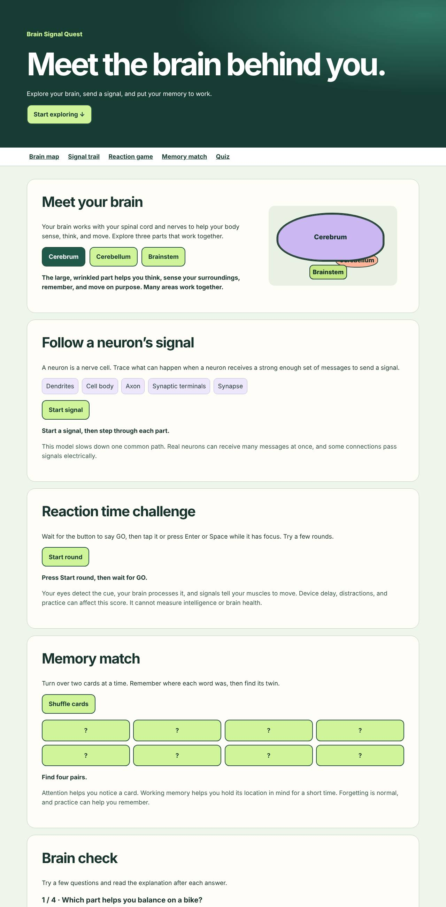 | 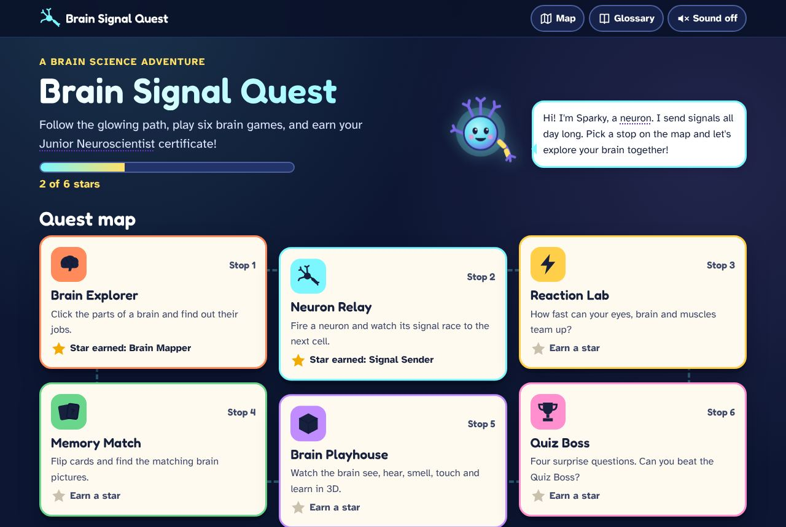 |

| Brain Explorer | Peek inside |
|---|---|
| 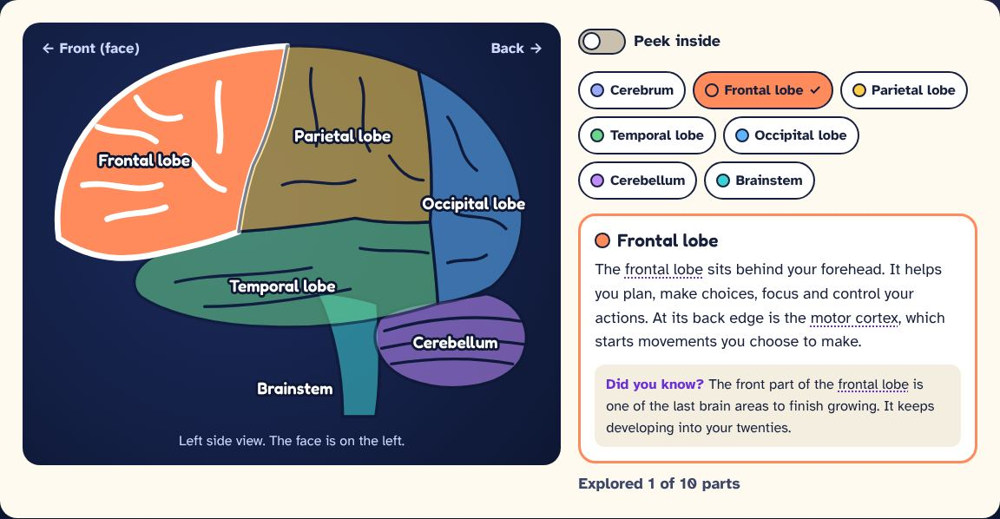 | 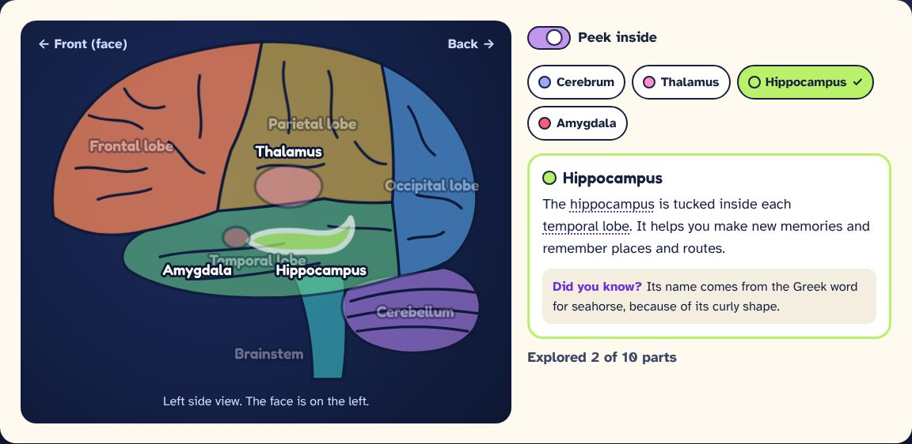 |

| Neuron Relay (action potential mid-axon) | Quiz Boss feedback |
|---|---|
| 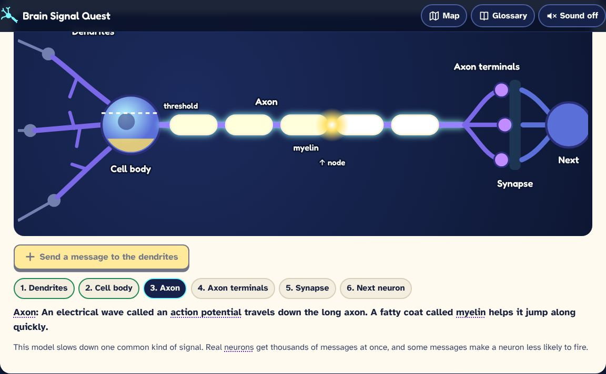 | 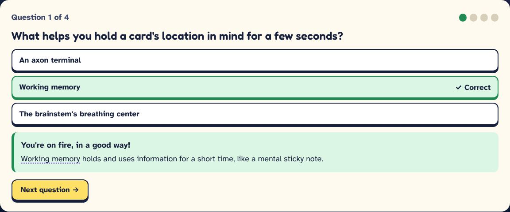 |

| Playhouse: optic chiasm crossing | Playhouse: "what" and "where" pathways |
|---|---|
| 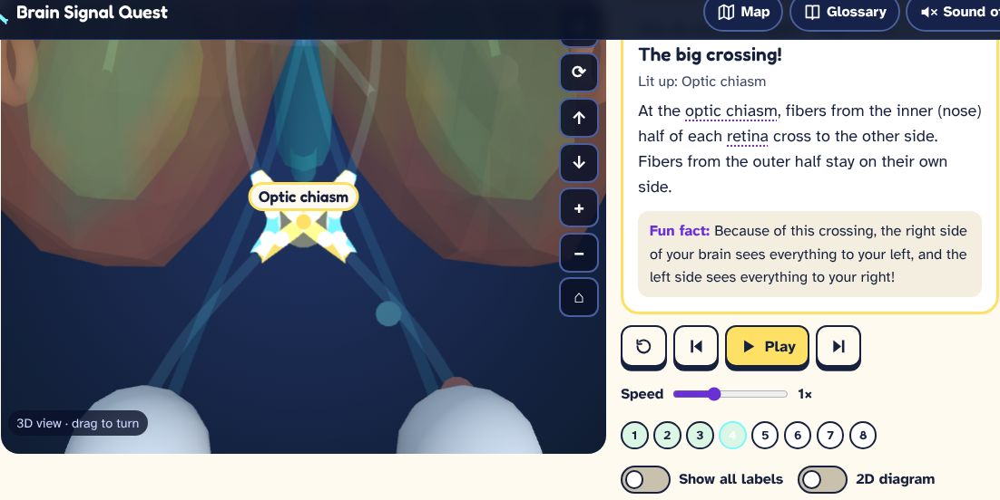 | 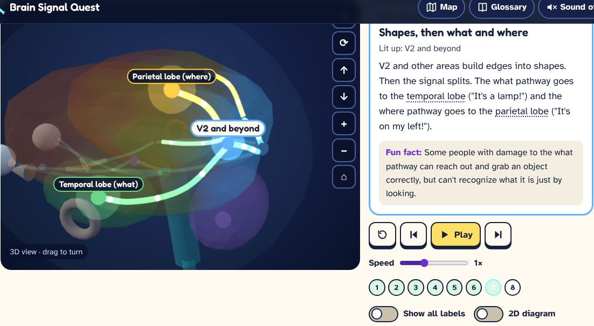 |

| Playhouse: spinal reflex (3D) | Same scenario, 2D fallback |
|---|---|
| 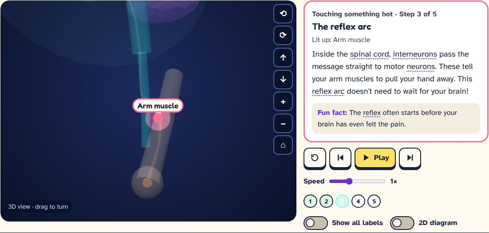 | 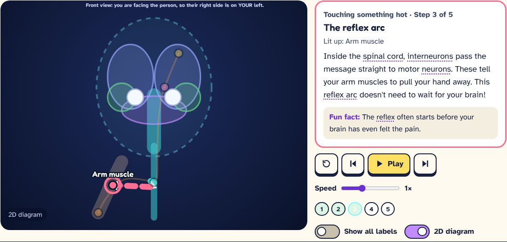 |

| Certificate | Mobile (390px) |
|---|---|
| 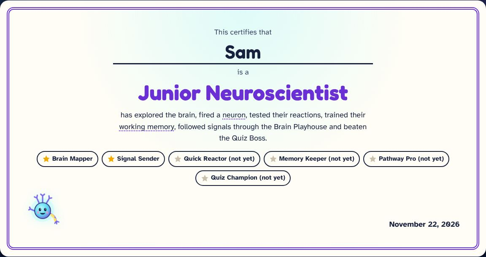 | 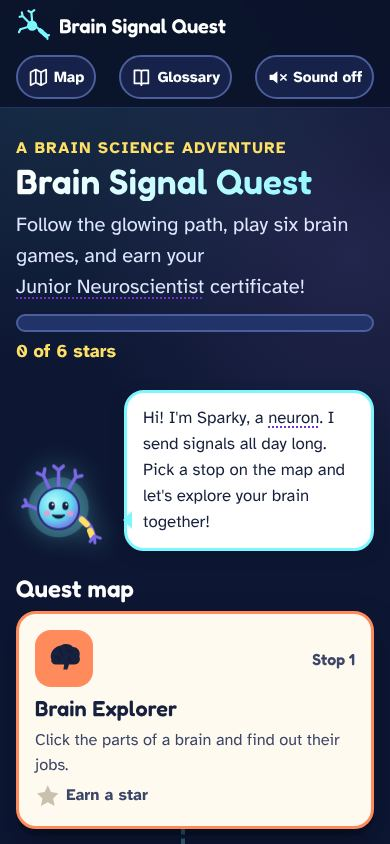 |

## Phase 1: audit (summary; full version in `docs/AUDIT.md`)
- **Worked:** no console errors, no horizontal scroll at 390px, a skip link, focus rings, live regions, and no trackers.
- **Broken or confusing:** the cerebellum was hidden behind the cerebrum blob (its label read "erebellum"), and the diagram wasn't clickable and was `aria-hidden`. The "neuron" was a row of word chips. The reaction game never explained the eye → brain → muscle loop it promised, and held keys auto-repeated. The quiz showed the same 4 questions in the same order, never showed which answer was right, and one question was about the app rather than the brain. Memory cards were words only, with weak matched styling.
- **Content:** 3 regions, a 3-word glossary and 3 sources, with no senses and no inner structures.
- **Missing:** a map or path, progress, rewards, a guide, celebration, a certificate and a consistent lesson structure.

## Phase 2: design brief (summary; full version in `docs/DESIGN-BRIEF.md`)
I studied PBS KIDS Games, NASA Space Place, Duolingo, ABCya, National Geographic Kids, BrainPOP, Prodigy and PhET (Neuron), plus BrainFacts and Neuroscience for Kids for tone. Khan Academy Kids blocked automated loading. Patterns borrowed (ideas only, no art or names):
- Dark "night" chrome with bright, colour-coded tiles (Space Place)
- A learning path with progress, green for correct and warm orange for try-again, chunky pressable buttons (Duolingo)
- One obvious action per screen and a greeting character (PBS KIDS)
- Play, pause, step and speed controls for a process (PhET)
- Short "Did you know?" facts (Nat Geo Kids)
- Explained quiz answers (BrainPOP)

**One colour per brain region is used everywhere**: the diagram, 3D lobes, buttons, cards and memory pictures. Fonts are Fredoka (headings) and Atkinson Hyperlegible (body, 18px).

## What changed
**Look and format**
- Design tokens (palette, region colours, radii, type) live in one place at the top of `style.css`.
- Self-hosted OFL fonts.
- **Sparky**, an original SVG neuron guide, greets players, gives hints and cheers.
- The home screen is a **quest map** of 6 stops with stars saved in `localStorage` (try/catch, badge flags only) and a progress bar.
- Every activity follows the same lesson shape: **Your mission → play → What just happened? → Brain in real life → badge**.
- **Glossary tooltips:** any of the 52 glossary words in the game text becomes a tap, hover or focus definition.
- Sound effects are generated with WebAudio and **muted by default**, with a toggle.
- Confetti and Sparky's hop are skipped under reduced motion.
- A printable **Junior Neuroscientist certificate**. The optional name stays on the page only.
- Old `#brain`, `#neuron` and similar links still work (hash routing).

**Activities**
- **Brain Explorer:** a new side-view SVG with the four lobes, cerebellum and brainstem, plus a **Peek inside** switch for the thalamus, hippocampus and amygdala. It can be clicked, tapped or operated by keyboard, and each part has a fact card with "Did you know?". The `cerebrum`, `cerebellum` and `brainstem` keys are kept.
- **Neuron Relay:** kids send messages to the dendrites and the cell body fills (with slow leak) past a **threshold** line. Then the action potential travels as a wave hopping node to node along the myelin, neurotransmitters cross the synapse and the next neuron lights up. Under reduced motion it becomes a step-by-step diagram.
- **Reaction Lab:** 5 rounds with average and best, then the eye → visual cortex → decision → motor cortex → spinal cord → muscles loop. It ignores key auto-repeat. Presses under 100 ms count as guesses, because they're faster than the loop can work. The lamp changes colour once per round, with no flashing.
- **Memory Match:** 6 illustrated pairs with a fact on each match and a turn counter.
- **Quiz Boss:** a pool of 20 questions with 4 drawn at random. It always shows the right answer and explains **why each wrong choice is wrong**.

**Brain Playhouse (new)**
- Three.js r170 is **vendored** and loaded with an import map. It's **lazy-loaded** only when the Playhouse opens (verified: no request before that).
- The brain is a procedural, semi-transparent, low-poly mesh tinted by region, with TubeGeometry pathways and travelling pulses. Floating labels show the active part, and everything else dims.
- Controls: OrbitControls (drag, pinch, scroll), plus rotate, tilt, zoom and reset buttons and arrow / `+` / `-` / `0` keys. Play, pause, step forward and back, restart, a speed slider, step dots, a "Show all labels" toggle and a **2D diagram** switch.
- **2D fallback** (SVG, same steps) is used automatically when WebGL is missing or reduced motion is on.
- **Six scenarios**, all data in `content.json`:
  - **See a light:** eye → retina (rods and cones) → optic nerve → **optic chiasm crossing** → optic tract → LGN → optic radiations → V1 → V2 → what/where streams, plus the bonus midbrain pupil reflex
  - **Touch something hot:** spinal reflex arc first, then the crossed pathway to the thalamus and somatosensory cortex
  - **Hear your name:** cochlea → auditory nerve → brainstem → midbrain → MGN → auditory cortex → Wernicke's area
  - **Catch a ball:** vision → parietal "where" → motor cortex ↔ cerebellum loop → crossing down the spinal cord → hand
  - **Smell cookies:** olfactory bulb → olfactory cortex (**no thalamus stop**) → amygdala → hippocampal area → frontal lobe
  - **Learn something new:** the path gets brighter and thicker with practice ("fire together, wire together") and sleep
- **Mini-challenges** after each scenario ("pick the part", or "put the steps in order" with up and down buttons) earn per-scenario badges.
- **Performance:** pixel ratio capped at 2, renders on demand when paused, and drops to pixel ratio 1 automatically if fps stays under 40.

**Content and CMS**
- `content.json`: 6 activities, 10 regions, 6 neuron stages, a 20-question quiz, 52 glossary terms with aliases, 22 sources, and 35 Playhouse structures, 48 pathways and 6 scenarios.
- `.pages.yml` covers **every** top-level key, including nested Playhouse steps, cameras and challenges. A check script confirmed config keys equal content keys.
- The Playhouse code normalises CMS edits: missing optional lists are OK, and unknown IDs are skipped instead of crashing.
- ⚠️ The old `brainIntro`, `neuronIntro`, `reactionIntro`, `memoryIntro` and `quizIntro` keys were folded into `activities[].goal` (same purpose, now alongside the other per-activity text). The region keys are unchanged.

## Science-accuracy pass
Every fact was re-read against OpenStax A&P 2e §12.4, §12.5, §14.1 and §14.2, BrainFacts, NIH NINDS *Brain Basics*, Chudler's *Neuroscience for Kids* and Kenhub. Fixes made during the pass:
- "The lens focuses light" became "the cornea and lens focus it" (the cornea does most of the bending), and Cornea was added to the glossary.
- The visual-agnosia fun fact was reworded to be precise.
- Ball tracking is now described as smooth pursuit plus catch-up jumps.
- Reaction times under 100 ms are rejected as anticipations.

Deliberate simplifications are labelled in the game: for example, "This model slows down one common kind of signal…" on the neuron, and Wernicke's area is "usually on the left".

## Testing
- Local `python3 -m http.server 8000` in Chromium (Playwright) at 1280×900 and 390×844, with automated full play-throughs of every activity, the Playhouse challenges, stars and the certificate. **0 console errors.** No horizontal scroll.
- **Keyboard-only:** every activity was completed in the play-through by focusing controls and pressing Enter or Space. The skip link is the first Tab stop.
- **Reduced motion** (emulated): the Playhouse starts in 2D, the neuron is step-by-step, and animations are off. The full play-through passes.
- **No WebGL** (`--disable-webgl`): the 2D diagram appears with a note, and Three.js is never downloaded.
- **Lighthouse (desktop, local server):**
  - Home and Brain: Performance 97, Accessibility 100, Best Practices 100, CLS 0.
  - Neuron, Reaction, Memory, Quiz, Certificate and References: Accessibility 100, Best Practices 100.
  - Playhouse: Accessibility 100, Best Practices 100, Performance 46 (see limitations).
- **FPS:** 45–50 fps while animating, but measured on **SwiftShader software rendering** (no GPU in the test container).
- **Privacy:** 0 external requests. `localStorage` only holds `{done:{…}, playhouse:{…}}`, and the certificate name is never stored.

## New third-party files and licenses
| File(s) | Source | License |
|---|---|---|
| `vendor/three/three.module.min.js`, `vendor/three/addons/controls/OrbitControls.js` | three@0.170.0 (npm) | MIT (`vendor/three/LICENSE`) |
| `fonts/fredoka-latin-wght-normal.woff2` | @fontsource-variable/fredoka 5.1.0 | SIL OFL 1.1 (`fonts/OFL-Fredoka.txt`) |
| `fonts/atkinson-hyperlegible-latin-{400,700}-normal.woff2` | @fontsource/atkinson-hyperlegible 5.1.0 | SIL OFL 1.1 (`fonts/OFL-AtkinsonHyperlegible.txt`) |

There are no downloaded 3D models or images. All artwork (Sparky, the brain SVG, the neuron, icons and the 3D brain) is original and drawn in code.

## Known limitations
- **No real-GPU or real-device testing yet.** FPS and the Playhouse Lighthouse score (46) come from a headless container with software WebGL under Lighthouse's 4× CPU throttle. Please try it on a Chromebook and a tablet. If it's slow, the 2D switch, the automatic pixel-ratio drop and render-on-pause help.
- Tested in Chromium only (not Safari or Firefox).
- `.pages.yml` was validated as YAML and against `content.json`, but not opened in the Pages CMS editor UI.
- Automated accessibility checks only. No manual screen-reader pass (NVDA or VoiceOver) yet.
- The 3D brain is stylised. Structure positions are approximately right relative to each other, but it isn't an anatomical atlas.
- Screenshots in `docs/screenshots/` add about 1.2 MB to the repo. They can be deleted after review.

🤖 Generated with [Claude Code](https://claude.com/claude-code)

https://claude.ai/code/session_013bb2S4bJXmhZ53VLBTp6Ky
